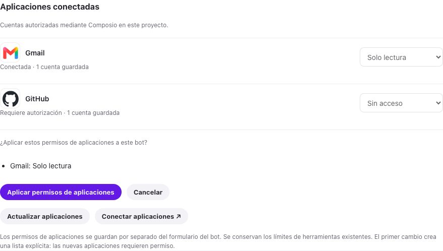
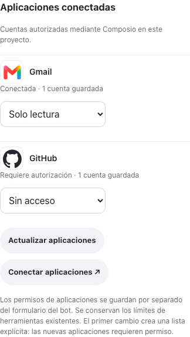

# Native application permissions inside the panel

## Overview

Bot application permissions can now be reviewed and applied from Fyso. No native
OpenMausBot settings page is required. Account authorization and MCP tool selection
keep their existing native contracts.

## User flow

1. Open a bot's Connectors section.
2. Choose No access, Read only or Read and write for a connected application.
3. Choose Review app permissions and inspect the proposed changes.
4. Apply app permissions. Fyso patches the exact native bot, verifies the result and
   versions its native permission patch in the project.
5. Refresh to reread permissions. Application access is saved independently from
   the other bot form fields; those retain Save → Review and apply.

## Acceptance matrix

| Behavior | Verification | Result |
|---|---|---|
| Permission reads reflect native bot state | Real browser / Dagu / OMB | Passed |
| Editing and reviewing do not change runtime | Native reread before Apply | Passed |
| Enable Gmail read-only on an initially disabled bot | Exact-ID native PATCH + reread | Passed |
| Disable Gmail from the panel | Native scope reread | Passed |
| Preserve unrelated bot permissions | Before/after projections of every other bot | Passed |
| Preserve partial tools and unrelated application scopes | Unit fixtures | Passed |
| Reject changed permissions, account state or dirty files | Unit fixtures | Passed |
| Restore patches after native IDs change | Simulated native API, stable name/section | Passed |
| Mobile has no horizontal overflow | 390px real browser assertion | Passed |

## Visual evidence

Executable local integration: reviewing a disposable bot's change to Gmail read-only
before Apply. Native permission reads confirmed that review alone did not mutate it.

Executable local integration at 390px: Gmail reads Solo lectura after native apply
and refresh. GitHub remains unconnected and cannot receive a new grant.

## Automated validation

Date: 2026-11-09. Environment: isolated project preview at `http://panel.localhost:19540`.

- `npm run build --prefix template/framework/panel`: passed.
- `node --test tests/*.test.cjs`: 66 passed.
- `mise run doctor` in the generated project: all checks passed.
- `FYSO_TEST_CONNECTORS=1 mise exec -- node <checkout>/tests/app-access-browser.cjs`
  from the generated project: real panel → Dagu → OMB passed, zero page errors.
- Browser test created one disposable bot, granted read-only, removed access,
  verified all other bot grants were unchanged and removed its bot and saved patch.

## Scope and limitations

No external account tools were invoked and no email content was read. The existing
Gmail authorization was used only to validate the availability prerequisite. This
proves permission configuration and native enforcement configuration, not an email
operation. Existing per-tool grants stay intact; this editor changes app-level
scope and does not replace native tool approvals or engine capabilities.

Restore was tested against simulated native APIs; production-style replay of saved
patches on existing bots was not run during this task. A broad restore discovery
check was rejected by automatic approval review; the actual integration instead
used only the newly created disposable bot. No permission expansion on user bots
was performed by verification.
