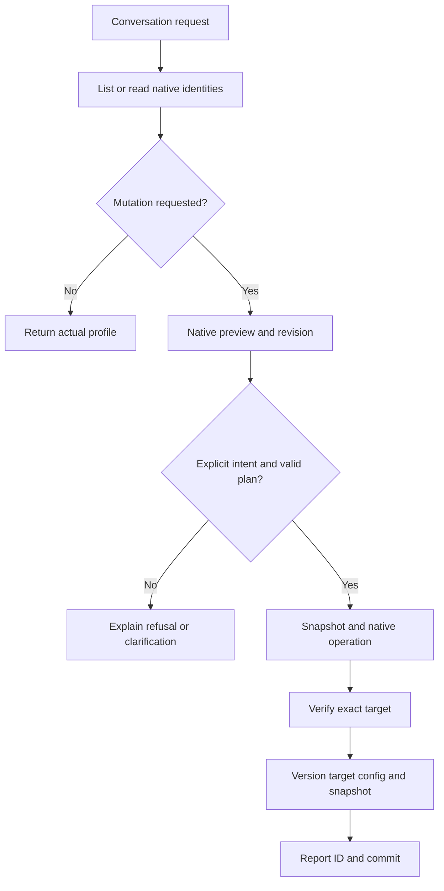
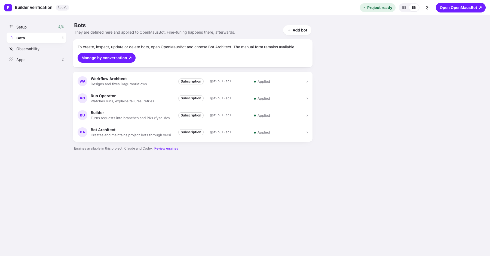

# Conversational Bot Architect — verified local delivery

## Overview

Bot Architect now creates, reads, updates and deletes project bots through one
native Dagu workflow. OMB remains the bot engine and native team schema; Git
snapshots preserve configuration and imported skills. The manual panel remains
available and links to conversational management in OpenMausBot.

## User flow

Open **Bots → Manage by conversation**, then choose **Bot Architect** in OMB.
Describe a role to create, ask about an existing bot, or request a targeted change.
The Architect resolves actual IDs, generates a native preview and applies explicit
requests through `fyso-bot-architect`. Exploratory requests only produce previews.
Ambiguous targets require clarification. The workflow refuses stale plans, secrets,
self-modification, protected deletion and active deletion; completed plans replay
their saved receipts. Each actual mutation has snapshots before/after and a Git
commit for only the target's project entry.



## Acceptance matrix

| Scenario | Result | Evidence |
|---|---|---|
| Natural-language create | Passed | Real Codex Bot Architect created `CRUD Proof`, ask/off, requested model/instructions |
| Natural-language read/update | Passed | Changed only requested title/soul and read them back |
| Natural-language delete | Passed | Exact restored ID removed; all other bot definitions preserved |
| Independent before/after audit | Passed | [Native Git audit](native-audit.json), all three conversational mutations |
| Restore after runtime loss | Passed | Recreated disposable bot plus `verification-helper` imported skill from versioned native bundle; unrelated profiles unchanged |
| Completed-plan replay | Passed | Same saved bot ID/commit; no duplicate creation |
| Stale-plan rejection | Passed | Newer title stayed intact after applying an old preview was refused |
| Protected bot and secret refusal | Passed | Real Dagu workflow tests; Chief retained and secret-bearing bot not created |
| Busy/self/unsafe profile guards | Passed, fixtures | Focused Node tests |
| User project installation | Passed | Only new Architect created through a partial native team; doctor green |
| Conversational panel entry | Passed, manual Chrome | Link opens the native project OMB origin; no console errors/warnings |

The isolated conversational receipt commits are `c8d8eca` (create), `c7b4d89`
(update), and `027b4f7` (delete). Restore deliberately creates a new native ID;
configuration and memory are restored by bot name. These are disposable-project
commits, not claims of a template-repository commit or remote delivery.

## Visual evidence

### Panel entry point

Manual Chrome, isolated generated project, port block 19240–19249. The final
panel lists Bot Architect and makes conversational management discoverable while
keeping the manual form. The disposable bot has been deleted. No credentials,
provider keys or user conversation bodies appear in the capture.

<details>
<summary>Bot Architect in the project panel</summary>
<p align="center"></p>
</details>

## Automated validation

```sh
node --test tests/*.test.cjs
FYSO_TEST_HTTP_PORT=19240 FYSO_TEST_BOT_CRUD=1 python3 -m unittest discover -s tests -v
npm --prefix template/framework/panel run build
mise run doctor
```

The Python command requires pinned `yaml` and `gitleaks` on PATH, and its opt-in
CRUD tests MUST target a disposable generated project. They create and remove
only their own uniquely named fixture bot. Results: **13 Node tests and 21 Python
tests passed**; TypeScript/Vite build, Dagu validation and shell checks passed.
Both the isolated project's doctor and the user's project's doctor passed.

## Scope and limitations

- Profile fields in this first version: name/title/description/model/inline soul,
  ask/full approval, computer off and project-root cwd. Engine credentials,
  computer provisioning, arbitrary tool policy and Chief assignments are excluded.
- Native partial-team application requires unambiguous names across teams. This
  surface rejects duplicates even when an exact ID is supplied, rather than risk
  updating a same-named teammate. Deletion itself always uses the exact ID.
- Dagu serializes this workflow; a manual UI change invalidates pending previews.
  Native config, Git and runtime writes are not one distributed transaction. A
  failure is surfaced, and the pre-operation snapshot is the recovery point;
  no automatic rollback or guaranteed success after partial failure is implied.
- Snapshot validation uncovered missing skill sidecars and incorrect relative-file
  resolution. The fix preserves imported project skill bundles, excludes ambient
  native CLI skills owned by the host, and preserves placeholders in inline souls.
  Known home/project paths are normalized only in the versioned copy. Live native
  memory and personal CLI skills are not rewritten. Staged path/secret checks run
  before snapshot commits.
- The automatic approval reviewer initially refused a combined installation and
  snapshot block because snapshots can push to a remote. Install/health checks
  were separated, both projects were confirmed to have no remotes, and explicit
  no-remote guards were used for the approved local snapshots. No remote push,
  public artifact or PR was created.
- Existing user bots were not restarted. Only the disposable test bot was removed
  during restore verification, and only fixture bots were removed by CRUD tests.
- Existing projects preserve `project/bots/team.yaml` on Copier update. Add the
  new Architect entry and apply its native partial team explicitly; do not replace
  an existing project team with the template's defaults. The current user project
  has already received this bounded installation.
