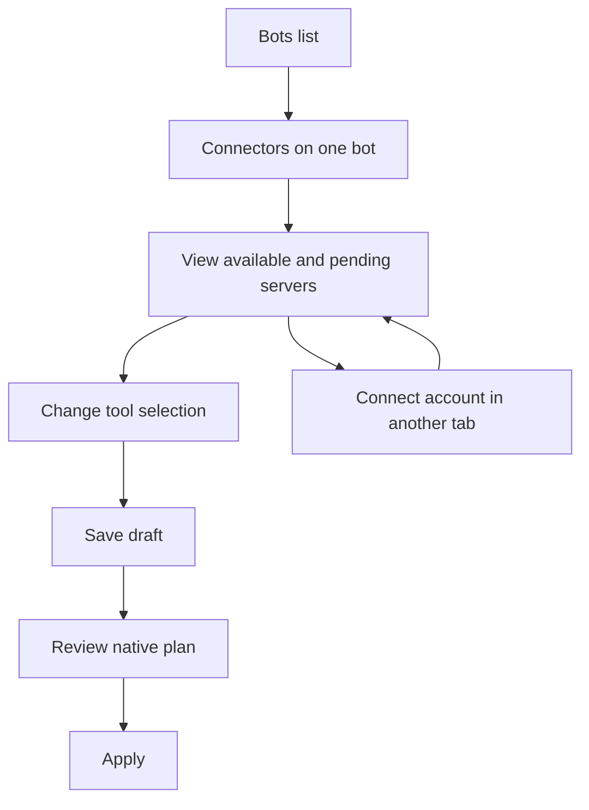

# Connectors visible inside each bot

> Recovery notice (2026-11-08): this is a reconstructed historical evidence record. Its PNG captures and live project no longer exist. Only source build and Node tests were rerun; see [recovery limits](../../../docs/connectors-recovery.md).

## Overview

The Bots list now shows MCP selections and a Connectors action. Each declared
bot opens its own editor at the connector fieldset; native-only profiles link to
the exact-ID native picker. Connector changes use the existing team draft and
native review/apply flow. On 2026-11-07, a real disposable-bot browser test verified
that selecting and saving did not mutate runtime until Apply, and unrelated bot
profiles stayed unchanged.

## Contents

- [User flow](#user-flow)
- [Acceptance matrix](#acceptance-matrix)
- [Visual evidence](#visual-evidence)
- [Automated validation](#automated-validation)
- [Scope and limitations](#scope-and-limitations)

## User flow



Connected native servers and project declarations are distinguished from pending
hosted services. Whop and Agentcard are listed as pending until authorized.
Existing partial access remains explicit, and native per-bot exclusions stay
disabled. Default Claude source settings are shown separately from the default
Codex engine, where those Claude switches do not apply.

## Acceptance matrix

| Scenario | Expected result | Status | Evidence |
|---|---|---|---|
| List entry | Bot row has a summary and named connector action | ✅ | Real browser |
| Form | Named action opens that bot's connector fieldset | ✅ | Real deep-link navigation |
| Available MCP | Native local fixture appears as enabled and selectable | ✅ | Real OMB metadata |
| Draft isolation | Editing and Save do not change running bot scope | ✅ | Independent native API assertions |
| Apply | Existing native preview/apply persists requested tool scope | ✅ | Native API readback |
| Other profiles | IDs, model, title, approval and tool selections preserved | ✅ | Before/after native projections |
| YAML | Other fields, file references, comments and profiles preserved | ✅ | Focused unit test |
| Conflicting edits | Team draft blocks the alternate immediate picker | ✅ | Read-only browser check |
| Mobile | No horizontal overflow | ✅ | Real 390 px browser check |

## Visual evidence

### Connector selection inside the bot

<details>
<summary>Show the bot editor</summary>

Real local capture of a disposable bot. The fixture MCP is selectable, project
servers are visible, and hosted presets remain pending. The selection is still a
draft at this checkpoint; the running bot was independently verified unchanged.

> Historical capture unavailable after recovery: `bot-connectors-editor.png` — Connector selection inside a bot editor with pending hosted services.

</details>

### Mobile editor

<details>
<summary>Show the mobile layout</summary>

The same real connector fieldset at 390 px, with the bot form's existing Save
footer. The executable check asserted no horizontal overflow.

> Historical capture unavailable after recovery: `bot-connectors-mobile.png` — Mobile bot connector editor.

</details>

### Bot list after apply

<details>
<summary>Show the resulting bot list</summary>

The list displays the saved MCP selection after native Apply. The test then
removed only its disposable bot and MCP, leaving the project running.

> Historical capture unavailable after recovery: `bot-connectors-list.png` — Bot list with connector summary and per-bot connector action.

</details>

## Automated validation

```sh
node --test tests/*.test.cjs
# 69 passed.

npm --prefix template/framework/panel run build
# TypeScript and production bundle passed.

# Run through mise in the explicitly selected disposable project:
FYSO_TEST_CONNECTORS=1 mise exec -- node "$FRAMEWORK_CHECKOUT/tests/bot-connectors-browser.cjs"
# Passed: named bot entry, native MCP selection, draft/runtime separation,
# native preview/apply, unrelated profile preservation, mobile, zero page errors.
```

The executable browser check uses one Chromium worker, native OMB/Dagu services
and a harmless MCP fixture. It creates no external account connections and sends
no bot messages. Temporary profiles and MCPs are removed in cleanup. A separate
read-only browser check confirmed the alternate live editor is disabled while a
local team draft exists.

## Scope and limitations

- Server availability and tool permission are separate. Pending services cannot
  become usable merely by selecting a bot permission.
- Personal engine MCP servers are not enumerated or copied from host files.
  Claude switches do not apply to the default Codex engine.
- App toolkit/account grants remain native OMB settings; this editor manages MCP
  tool selection. Partial selections remain intact unless explicitly changed.
- Native-only/ambiguous profiles preserve their existing import and exact-ID
  boundaries. Full external-provider acceptance remains separate.
- No CI, deployment or acceptance of unrelated concurrent work is claimed.

Use [the connector contract](../../../docs/connectors.md#connectors-inside-bot-configuration).
The isolated panel remains available at `http://panel.localhost:19540/#/bots`.
