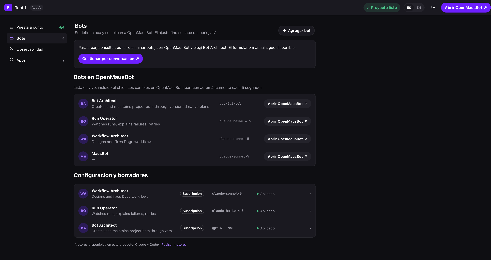

# Native bot discovery — 2026-11-06

Local manual Chrome verification at `http://panel.localhost:18400/#/bots`.

- The live roster displays all four existing native bots, including MausBot; the navigation count is four.
- Created one empty disposable bot through native OMB POST, then renamed it through PATCH while the panel remained open. The renamed bot appeared after polling without navigation or reload.
- Deleted only that exact disposable ID. The panel removed it automatically, and all four original native IDs remained present.
- Authenticated roster GET returned 200, write attempts returned 405, and a non-allowlisted path returned 404. The gateway requests native `messages=0`; no general administration proxy is added.
- Console: no errors or warnings observed. `mise run doctor`: all checks passed after gateway startup. TypeScript/Vite build and 13 Node checks passed.
- Regression command: `FYSO_TEST_HTTP_PORT=18400 python3 -m unittest discover -s tests -p test_bot_roster_http.py -v`.

Manual Chrome capture: the native roster shows the chief and live models; the navigation count agrees. Manual configuration and drafts remain below, independent of discovery. Native edits do not automatically reconcile into project declarations; existing snapshots retain native state.
