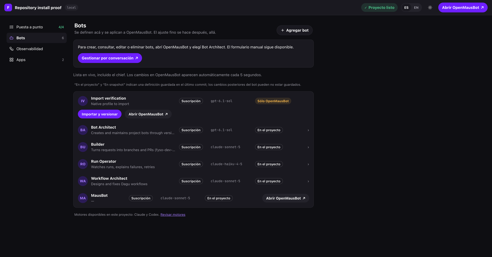
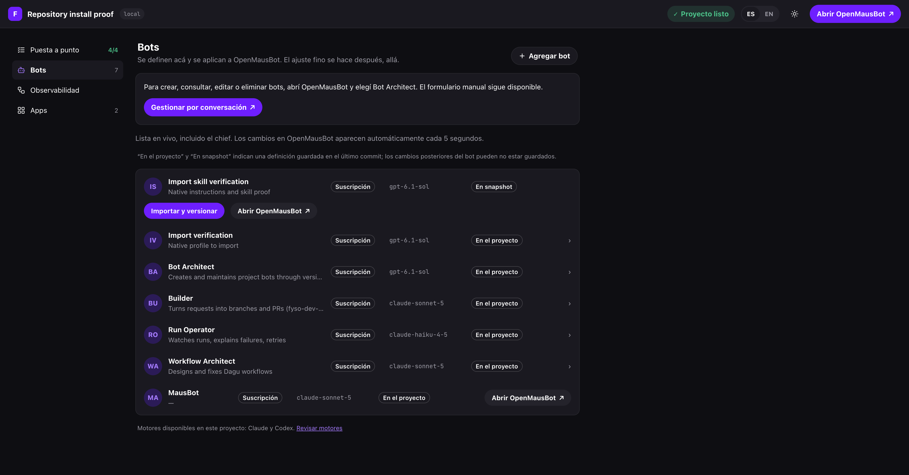
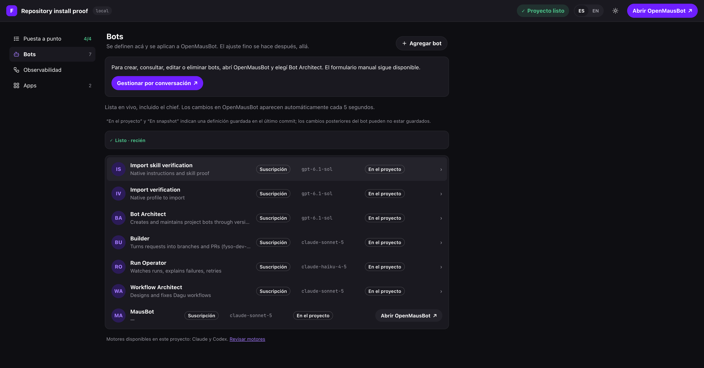

# Native bot import — 2026-11-06

## Acceptance

Manual Chrome against the isolated generated project on port 19280:

1. A native-created disposable bot appeared once as **OpenMausBot only**, with an import action.
2. A second disposable bot with real instructions and an imported skill was snapshotted through the native workflow. Its label became **In snapshot**, distinct from a project declaration.
3. Clicking **Import and version** enqueued `fyso-bot-architect` with `OP=import` and the exact native ID. Dagu succeeded, a local project commit was created, and the row became **In project**, with an edit action and no duplicate row.
4. Independent before/after native API comparisons confirmed every existing bot's profile and the target's native ID/instructions remained unchanged. The imported skill was committed under a project-owned relative path. See [native-audit.json](native-audit.json).
5. Replaying the operation returned `replayed:true` and created no extra commit.
6. A further default-folder/auto-computer native profile proved shared project defaults do not silently change imported settings: the native full-team check returned **No changes** and doctor passed. Import materializes existing effective defaults when needed before removing shared inheritance.

No bot turns or model requests were sent. Native fixture bots were removed after verification and its stack was stopped. The user's own bots were not used for import tests.

## Captures

Manual Chrome: a newly created native bot has no committed definition and offers import; existing project declarations remain distinct.

Manual Chrome: a saved native snapshot provides Git evidence without pretending the bot is declared in the project.

Manual Chrome: the import completed through Dagu; the bot is in the project and remains a single row. No console errors or warnings observed after successful interactions.

## Checks and limits

- TypeScript/Vite build passed.
- 19 Node checks passed on pinned Node 24.15.0, including committed-evidence classification and ignoring uncommitted file contents.
- Python suite: 15 passed, 13 opt-in runtime checks skipped without flags. Four new fixture tests cover inline import, imported skill files, idempotency, dirty project guards, commit-failure rollback and native default inheritance.
- Three real HTTP regressions passed with `FYSO_TEST_HTTP_PORT=19280`: authentication, read-only routes and absence of profile/chat content in Git metadata.
- The initial inline-profile test exposed an empty-sidecar path passed to Git commit. The corrected importer commits only paths with files and rolls back its own project writes if commit fails. This failure is covered by regression tests.
- The user project doctor passed after installation, with a nonfatal native/project drift warning; no user runtime profiles were changed to silence it.

Git metadata refreshes on startup, snapshots, import, manual apply and scheduled observability collection. A badge proves a saved definition exists at the reported commit, not that later native edits are saved. Dirty project declarations and panel drafts block import. Import is local versioning; it does not itself push to a project remote. No remote CI or deployment result is claimed.
