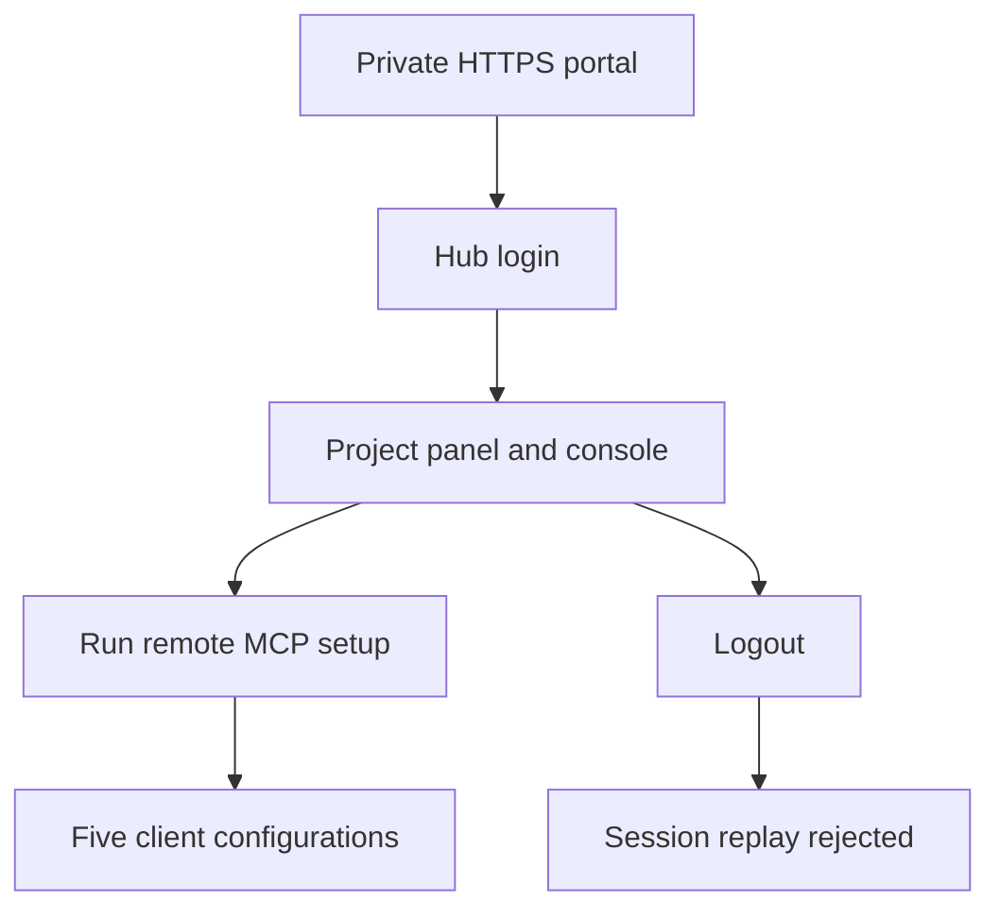
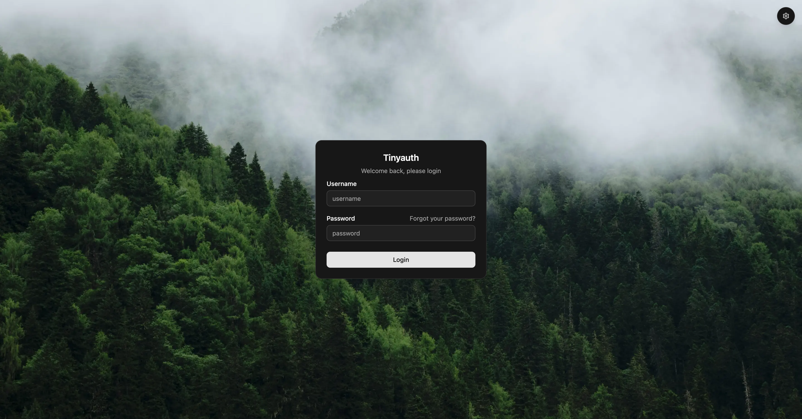

# Cloudflare private HTTPS — delivery evidence

## Overview

On 2026-11-12, `juancarlosvm` received a publicly trusted Let's Encrypt certificate,
private DNS names under `jc.fyso.dev`, and a native Caddy TLS entry point forwarded
only through Tailscale. The hub and three project doctors pass. Live MCP setup and
transport checks pass. Deployed authenticated browser acceptance remains pending.

## Contents

- [User flow](#user-flow)
- [Acceptance matrix](#acceptance-matrix)
- [Visual evidence](#visual-evidence)
- [Automated validation](#automated-validation)
- [Scope and limitations](#scope-and-limitations)
- [Handoff signals](#handoff-signals)

## User flow

Connect to Tailscale and open `https://portal.jc.fyso.dev`. The hub asks for its
existing credentials. Its session should open the portal, project panels and
consoles. In each panel's MCP screen, **Run** enqueues the native Dagu setup and
displays five client configurations. Logout must invalidate that shared session.



## Acceptance matrix

| Scenario | Expected result | Status | Evidence |
|---|---|---|---|
| Publicly trusted TLS | Certificate validates from the client machine | ✅ | Real curl verification result 0; Let's Encrypt YE1; expiry 2027-02-10 |
| Private routing | Portal, auth, console and all 13 declared project app routes have valid TLS | ✅ | 16 hostname probes: auth 200, protected routes 401; Tailscale-only TCP 443 |
| Native health | Hub, Auditor, EMOS and Manolito doctors pass | ✅ | Four live exit codes 0 |
| Certificate reload | Auditor's native deploy hook validates and reloads hub TLS | ✅ | Complete hook executed successfully |
| Live MCP transport | Dagu succeeds; token absent from outputs; HTTPS initializes | ✅ | [Auditor](auditor-mcp.json), [EMOS](emos-mcp.json), [Manolito](manolito-mcp.json) |
| Shared auth/security fixture | One login across three native gateways; cross-origin and replay rejection | ✅ | Four native hub integration tests; simulated app/console upstreams |
| Deployed shared browser session | One hub login opens portal, consoles and all three panels | ⚠️ | Interactive login pending |
| Deployed MCP UI | Click Run and see five configurations in each project | ⚠️ | Browser interaction pending |
| Deployed logout/security | Logout invalidates session in all targets; foreign writes rejected | ⚠️ | Authenticated browser/API checks pending |

## Visual evidence

### Deployed HTTPS login

<details>
<summary>Open the deployed login capture</summary>

The connected Chrome browser reached the real HTTPS hub login without a certificate
warning. Fields are empty. This proves the login entry state, not authentication.

<p align="center"></p>

</details>

## Automated validation

The live opt-in verifier is [cloudflare-remote-live.cjs](../../../tests/cloudflare-remote-live.cjs).
It runs inside one target project's mise environment, enqueues `MODE=remote`, reads
the encrypted token only in memory, checks Dagu outputs, and initializes the real
trusted HTTPS MCP endpoint. It never prints credentials or client commands.

```sh
mise exec -- node /path/to/tests/cloudflare-remote-live.cjs
```

Observed for all three deployed projects: `succeeded`, no token in Dagu outputs,
successful initialization, 26 platform tools and no Dagu tools.

The focused framework suite passed 26 tests with no failures or skips, including
real SOPS/age token creation, the adapter boundary, encrypted extension setup,
Cloudflare provider-error redaction and shared-login environment refresh:

```sh
node --test tests/mcp-remote.test.cjs tests/composio-setup.test.cjs \
  tests/cloudflare-certificate.test.cjs tests/web-origin.test.cjs
```

Set `FYSO_TEST_SOPS` and `FYSO_TEST_AGE_KEYGEN` to explicit native binaries to include
the real encrypted token-creation case. `scripts/check-paths.sh` and
`git diff --check` also passed.

The separate hub change is preserved in [hub-https.patch](hub-https.patch), including
its tests. Its native fixture uses explicit Caddy and Tinyauth binaries, a framework
checkout, fictitious users and self-signed certificates trusted only by that test.
All four tests passed on the Linux ARM64 VM. No production trust bypass was used.

```sh
FYSO_TEST_CADDY=<binary> FYSO_TEST_TINYAUTH=<binary> \
FYSO_TEST_FRAMEWORK_ROOT=<framework-checkout> node --test tests/https.test.cjs
```

## Scope and limitations

- Issuance and DNS credentials temporarily remain in Auditor, explicitly authorized
  by the administrator. Moving them to the hub is deferred.
- A 401 proves the protected routing boundary, not the final app's authenticated
  functionality. Actual app and console navigation still requires browser acceptance.
- Native MCP/Dagu verification does not replace clicking Run in the real panel.
- Existing DNS records were preserved. The new records point to the private Tailscale
  address and have Cloudflare proxying disabled. No Cloudflare Tunnel was created.
- Local changes in Auditor were retained, including its import UI and app behavior;
  the app URL changed to its new HTTPS domain. Recovery copies remain on the host.
- Source changes are local and reviewable; no merge or release is claimed.

## Handoff signals

The connected Chrome tab is waiting at `https://auth.jc.fyso.dev` for an existing hub
login. Do not send credentials in chat. After interactive login, continue the pending
shared-session, panel Run and logout checks before declaring the goal complete.
