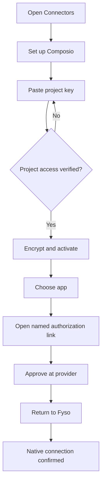
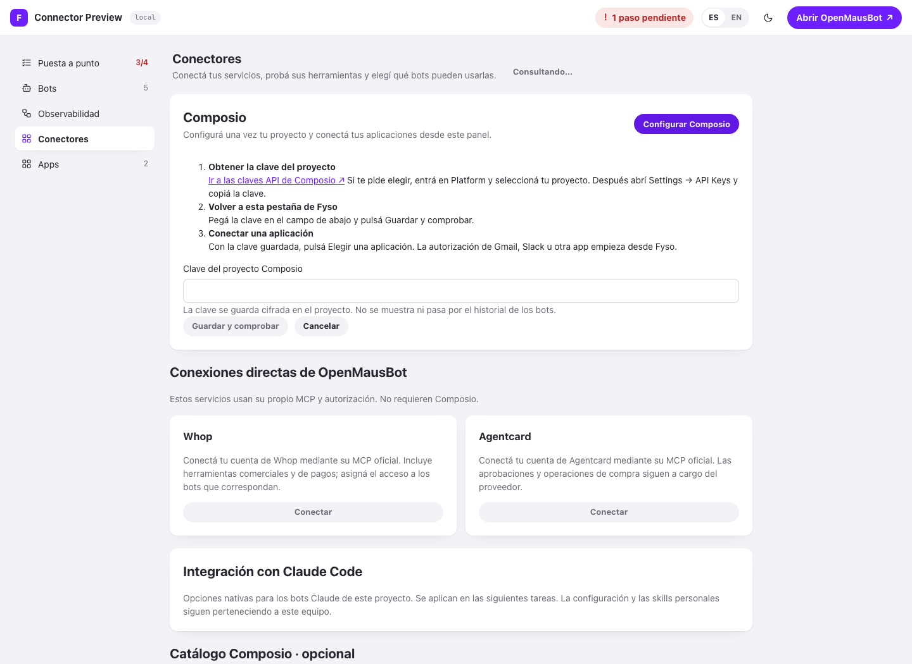
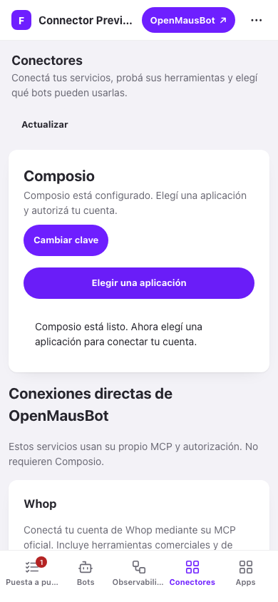
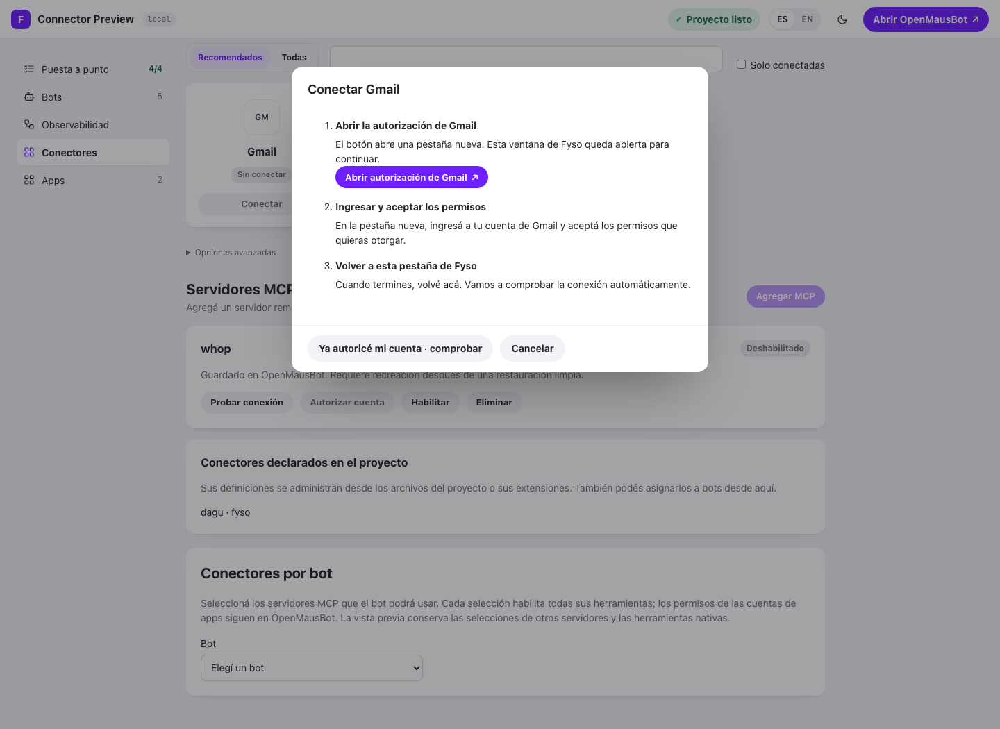
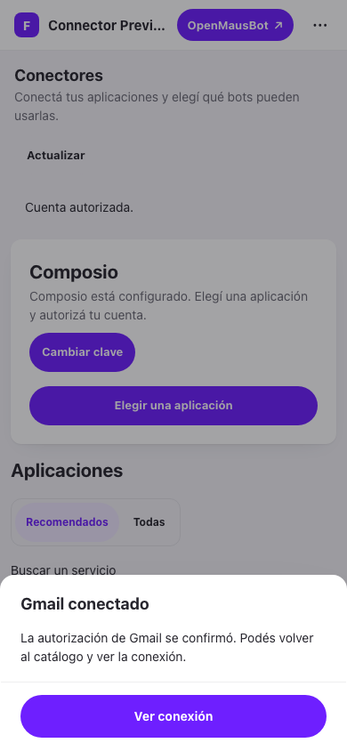

# Guided Composio setup — local delivery

## Overview

The Connectors panel now lets a project owner configure Composio without editing secrets or restarting OMB. Local UI and persistence tests passed on 2026-11-08. External account OAuth remains unverified without a real project key.

## Contents

- [User flow](#user-flow)
- [Acceptance matrix](#acceptance-matrix)
- [Visual evidence](#visual-evidence)
- [Automated validation](#automated-validation)
- [Scope and limitations](#scope-and-limitations)

## User flow

Open Connectors, choose Set up Composio, follow the dashboard link, copy a project key and select Save and verify. A rejected key leaves the form available for correction. A valid key is encrypted, versioned and activated; the person then chooses an app and authorizes an account through native OMB.

## Acceptance matrix

| Scenario | Expected result | Status | Evidence |
|---|---|---|---|
| Project setup form | Password field, dashboard instructions, save action | ✅ | Desktop capture and browser test |
| Rejected key | Localized error, cleared field, correction supported | ✅ | Browser fixture and endpoint tests |
| Native save | Real SOPS encryption, existing secret preserved, scoped Git commit | ✅ | SOPS proof with generated credentials |
| Restart | Current encrypted value overrides stale supervisor key | ✅ | SOPS/restart-source proof |
| Credentials | No Dagu/body logs, CLI arguments or browser storage | ✅ | Source contract and focused assertions |
| Mobile | No horizontal overflow; ready state | ✅ | Mobile capture and browser test |
| Guided connection | No blank tab, clear provider action, confirmation on return | ✅ | Local-consent browser test |
| Check failure | Visible retry guidance and automatic recovery | ✅ | One simulated 503 then native-state success |
| Real external account | Account authorized and bot performs a read | ⚠️ | Pending real project key and user OAuth |

## Visual evidence

### Project setup

Desktop setup form

The real preview UI shows the three setup steps and an empty password field. Produced by the executable local browser test with setup/catalog response fixtures; it proves presentation, not provider acceptance.

### Ready state on mobile

Mobile ready state

The browser fixture first rejects a test key, then accepts a corrected submission. This capture shows the ready state with the password field removed and no mobile overflow. No real key is saved by the browser test.

### Authorization next step

Named authorization instructions

The real panel presents the next action before opening a provider tab. The executable test uses native account API fixtures and a real local consent page; it confirms no blank tab, cancellation before opening, and automatic confirmation after returning.

### Confirmed connection

Mobile confirmation on return

After local consent, the test returns to Fyso, observes a temporary check failure and then receives a native-state fixture confirming the connection. No manual confirmation click is needed. The dialog offers View connection and fits a 390px viewport.

## Automated validation

- `npm run build --prefix template/framework/panel`: passed (existing chunk-size advisory).
- `node --test tests/*.test.cjs`: 63 passed, 0 failed.
- `node tests/composio-setup-sops.cjs` under the generated project's mise environment: passed; real SOPS/Git, generated test age key, provider/native responses are fixtures. Restart test substitutes a harmless OMB executable and checks the supplied key without starting a server.
- `node tests/composio-setup-browser.cjs`: passed; headless Chromium, one context, no retries, 1440px and 390px. Two setup requests (422 then 200), no page exceptions and no key in Dagu or browser persistence. Setup/catalog responses are intercepted; the frontend and gateway are real.
- `node tests/connector-guided-authorization-browser.cjs`: passed; one context, no retries, native APIs intercepted, real local consent page. Explicit opening, no blank tab, cancellation, a temporary 503 and automatic confirmation on return verified; no page errors or mobile overflow.
- `tests/connectors-oauth-browser.cjs`: passed against real OMB with a local OAuth/PKCE provider; exact native MCP enabled and tested, fixture removed afterward. No external account exercised.
- `tests/native-connector-options-browser.cjs`: passed with mocked writes/hosted sign-in; personal preference values unchanged.
- `mise run doctor` in the isolated preview: all checks passed, including setup service health.
- Shell syntax, portable paths and Git whitespace checks passed.

## Scope and limitations

The live setup adapter is available at `http://panel.localhost:19540/#/connectors`. Browser error/ready paths use fixtures; a real project key was not supplied, so external-provider validation, account OAuth and bot execution remain separate acceptance steps. These captures contain no real credentials.

Native OMB maintains its private runtime credential storage. Project configuration is encrypted and versioned. This delivery remains on the recovered branch baseline; integration with newer main authentication/extension changes is still pending. No source commit, PR, merge or deployment is claimed.

## Withdrawn CLI experiment

The browser/CLI alternative was removed on 2026-11-09 by user request after its live trial failed to return a usable project key. Its UI, backend routes, dependency, tests and screenshot were removed. The manual encrypted-key setup and native app authorization remain supported. [Historical findings](../../../docs/adr/spikes/composio-cli.md).
