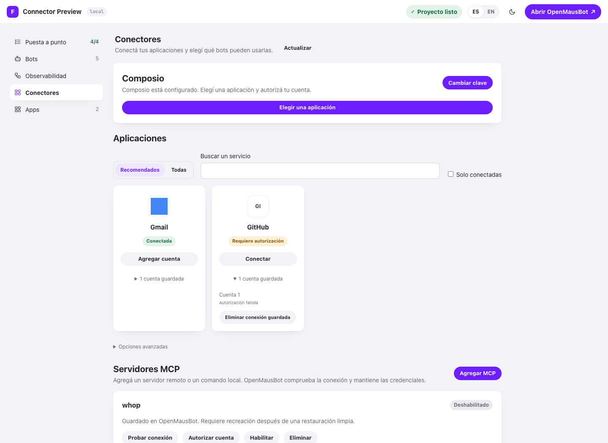
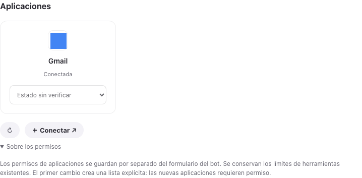
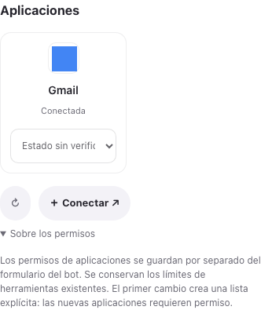

# Connected applications inside bot settings

## Overview

Bot settings now display native Composio account inventory separately from MCP server
selection. Account cards explain failed or expired authorization and scope additional
account names to their application.

## User flow

Open Bots → a bot's Connectors action. Connected applications appear first. Refresh
applications without waiting for MCP discovery. Connect applications opens the panel
catalog; application permissions now use the in-panel review/apply controls documented in
[the application access evidence](../app-permissions/README.md). MCP switches retain their
existing draft/review/apply behavior and do not edit application grants.

## Acceptance matrix

| Behavior | Evidence | Result |
|---|---|---|
| Active Gmail and failed GitHub appear in bot settings | Executable native response fixtures | Passed |
| Failed accounts say authorization failed and offer removal, not Disconnect | Catalog browser assertions | Passed |
| Additional account naming belongs to its app card | Browser input/cancel assertions | Passed |
| Application refresh reflects changed native inventory | Browser read fixture | Passed |
| No account or grant writes | Intercepted native application requests | Passed |
| Narrow viewport has no horizontal overflow | 390px browser assertion | Passed |
| Existing guided consent still completes | Local provider consent regression | Passed |

## Visual evidence

Local UX fixture: active Gmail and failed GitHub have distinct account statuses and actions.

Local UX fixture: Gmail appears in bot settings independently of the MCP picker, with explicit permission guidance.

Local UX fixture at 390px: actions wrap inside the editor without horizontal overflow.

## Automated validation

Date: 2026-11-09. Environment: isolated local preview at `http://panel.localhost:19540`.

- `npm run build --prefix template/framework/panel`: passed.
- `node --test tests/*.test.cjs`: 64 passed.
- `node tests/connected-apps-visibility-browser.cjs`: passed; zero page errors.
- `node tests/connector-guided-authorization-browser.cjs`: passed using a local consent provider.
- `mise run doctor` in the generated preview: all checks passed.
- Live browser read without account API fixtures: Gmail appeared in a declared bot editor; no account or grant mutations were performed.

## Scope and limitations

Screenshots and presentation assertions use fictional account fixtures. They do not
prove external OAuth acceptance, per-bot application authorization or a bot tool call.
Application grant editing now calls native OMB through the in-panel workflow; it
does not add a second permission model or silently enable accounts for any bot. Existing
accounts, bot grants and encrypted credentials are preserved.
