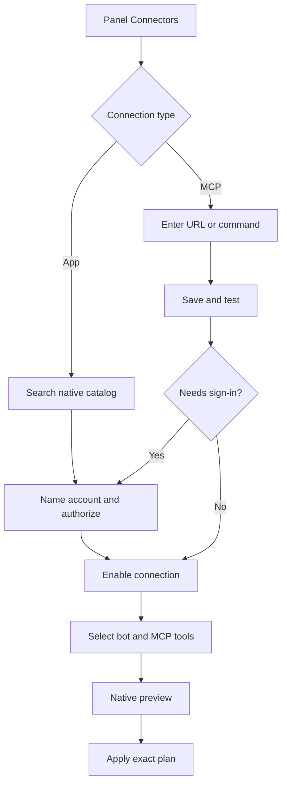

# Connector management inside the panel

> Recovery notice (2026-11-08): this is a reconstructed historical evidence record. Its PNG captures and live project no longer exist. Only source build and Node tests were rerun; see [recovery limits](../../../docs/connectors-recovery.md).

## Overview

The panel now manages connectors directly at `#/connectors`. On 2026-11-07, a
disposable project running OpenMausBot 0.1.141 and Dagu 2.24.0 passed native MCP
creation, discovery, enable/disable, versioned per-bot access and removal through
the real browser UI. Native OAuth with PKCE passed against a local test provider.
External provider accounts were not used.

## Contents

- [User flow](#user-flow)
- [Acceptance matrix](#acceptance-matrix)
- [Visual evidence](#visual-evidence)
- [Automated validation](#automated-validation)
- [Scope and limitations](#scope-and-limitations)
- [Handoff signals](#handoff-signals)

## User flow



Provider authorization opens its own window. Everything else stays in the panel.
The account disconnect and MCP remove actions require a focused confirmation;
they never broaden the remaining bot selections.

## Acceptance matrix

| Scenario | Expected result | Status | Evidence |
|---|---|---|---|
| App discovery | Native catalog, search, account aliases and setup state in panel | ✅ | Real fallback catalog, 24 apps; browser smoke |
| MCP creation | URL or local command accepted by native OMB | ✅ | Real local command, native tool discovery |
| Connection state | Enable/disable targets one server | ✅ | Real API verification and browser assertions |
| Bot access | Read current scope, preserve other servers, native preview/apply | ✅ | Native API readback and versioned workflow |
| Native exclusions | A bot's native server exclusion cannot be overridden by the picker | ✅ | Disposable bot filter and disabled-checkbox assertion |
| OAuth | Native registration, PKCE, provider return and authenticated probe | ✅ | Real OMB with a local OAuth provider |
| Secret handling | OAuth token not rendered or returned by native metadata listing | ✅ | Local-provider browser assertions |
| Gateway | Authentication, foreign-origin/cross-site rejection, restricted paths/methods | ✅ | Three real gateway tests |
| Failure | Unavailable MCP read hides stale server state; apps remain separate | ✅ | Injected final GET failure in browser test |
| Removal | Exact server removed after confirmation | ✅ | Real browser and independent native API check |
| Mobile / language | ES/EN and no horizontal overflow | ✅ | Browser smoke and screenshots |
| Real Gmail/Slack account | Provider sign-in with a configured Composio account | ⚠️ | Project Composio is not configured; setup notice shown |

## Visual evidence

### Native catalog and created MCP

<details>
<summary>Show the integrated screen</summary>

Real local browser capture after adding and testing a harmless MCP from the panel.
The native catalog and discovered tool names are displayed in the same screen.

> Historical capture unavailable after recovery: `connectors-created.png` — Native app catalog and tested MCP inside the panel.

</details>

### Per-bot permission preview

<details>
<summary>Show the native plan before apply</summary>

The selected disposable bot gains only the selected MCP server while retaining
its native tools. The actual OMB preview precedes the explicit Apply button.
After apply, the test independently read native `toolScope` to verify the result.

> Historical capture unavailable after recovery: `connector-bot-preview.png` — Per-bot connector selection with a native OMB permission preview.

</details>

### Mobile

<details>
<summary>Show the mobile panel</summary>

Real local capture at 390 px. Cards/actions wrap within the viewport and the
navigation has a direct Connectors entry. The smoke asserts no horizontal overflow.

> Historical capture unavailable after recovery: `connectors-mobile.png` — Mobile connector panel with direct navigation.

</details>

## Automated validation

```sh
node --test tests/*.test.cjs
# 65 passed.

npm --prefix template/framework/panel run build
# TypeScript and production bundle passed.

FYSO_TEST_HTTP_PORT=19540 python3 -m unittest discover -s tests -p test_connectors_gateway.py
# 3 passed: native catalog, auth/origin checks, closed routes and methods.
# The combined connector + existing OMB gateway regression run passed 8 tests.

FYSO_TEST_PANEL=http://panel.localhost:19540 node tests/connections-browser.cjs
# Passed: Apps → Connectors navigation, native catalog and mobile overflow check.

# Through mise in the disposable generated project, with its secrets loaded:
FYSO_TEST_CONNECTORS=1 mise exec -- node "$FRAMEWORK_CHECKOUT/tests/connectors-panel-browser.cjs"
# Passed: real MCP create/probe/toggle, native bot exclusions, preview/apply,
# native scope readback, removal, ES/EN, mobile and injected read failure.

FYSO_TEST_CONNECTORS=1 mise exec -- node "$FRAMEWORK_CHECKOUT/tests/connectors-oauth-browser.cjs"
# Passed: actual native OMB OAuth + PKCE against a local provider;
# token-bearing native probe, enablement and token non-disclosure assertions.
```

The browser tests each use a single worker and explicit disposable-project
environment. Temporary MCP definitions and bots are removed after their tests.
The fixture MCP is `tests/fixtures/connector-mcp.cjs`, copied into the disposable
project as `project/connector-proof.cjs`.

## Scope and limitations

- The catalog and normal MCP/bot flows use real local OMB/Dagu services. Only the
  final failing inventory GET is injected. The OAuth provider is a local fixture,
  while discovery, PKCE, token storage and authenticated probing are native OMB.
- External app authorization needs this project's Composio setup and the person's
  provider consent. No Gmail, Slack or other external account acceptance is claimed.
- Connected-app toolkit/account grants remain native OMB Access settings. The
  versioned picker changes MCP tool scope, not those native grants.
- Project-declared MCP definitions keep their source-file ownership. Native-only
  OMB definitions and OAuth sessions are not restored from the team snapshot; the
  screen labels that boundary. No new credential store is introduced.
- Native tool selection is not a shell/network sandbox. A server checkbox grants
  all its tools; partial existing selections are labeled before any replacement.
- CI, deployment and unrelated concurrent web-auth/extension work are separate.

## Handoff signals

The generated project doctor passed, including native instance identity,
gateway access and bot declaration match. `git diff --check` and the repository
path guard passed.

The project remains running for interactive testing at
`http://panel.localhost:19540/#/connectors` with its disposable admin login.
See [the contract](../../../docs/connectors.md) for configuration and restore
boundaries. The [initial groundwork evidence](../connectors/README.md) describes
the earlier link-out UI and is superseded for the user-facing flow.


## App setup state correction

The live fixture returned `configured:false`, `mode:unavailable`,
`setup:needs-setup`, `source:curated` and an empty account inventory. Its 24 app
cards are catalog entries, not connected accounts. The panel now labels these
**Setup required**; missing or incomplete inventory remains **Status unverified**.
A focused state test covers setup, unknown, disconnected, pending and connected.
The real browser verified all 24 setup badges and no false disconnected badges.

> Historical capture unavailable after recovery: `connectors-setup-required.png` — Native backend requires setup before any app can connect.


### Live native-source controls

Actual panel capture with no Composio configuration: both hosted Connect buttons
are enabled, and the two native Claude preference switches remain off. This
capture uses real metadata and readback, with no intercepted responses.

> Historical capture unavailable after recovery: `native-options-live.png` — Live direct MCP connections available without Composio and independent disabled Claude switches.

The generated project's doctor passed after the preference workflow installation.


## Native hosted presets and Claude switches

The panel now mirrors the pinned OMB direct hosted MCP cards for Whop and
Agentcard. Composio remains a separately labeled optional catalog. Two native
Claude switches read only `claudeUserMcp` / `claudeUserSkills` through the scoped
Dagu workflow; saves version the native patch, and `up` restores it.

Real native verification read both flags as off, saved them still off, then
restored the versioned patch successfully. No personal MCP/skills were enabled.
The true-state save/restore unit checks use a fake native API. Browser tests verify
independent switch payloads, reuse of an existing Whop endpoint, Agentcard creation
and native sign-in initialization with intercepted writes and a local blank
provider. They assert the real native flags remain unchanged. External Whop and
Agentcard authorization, and LLM use of personal Claude sources, remain unverified.

```sh
node --test tests/*.test.cjs
# 68 passed after the native-source additions.

FYSO_TEST_PANEL=http://panel.localhost:19540 FYSO_TEST_OMB_PORT=19544 node tests/native-connector-options-browser.cjs
# Passed: real preference read; mocked switch writes and hosted MCP sign-in;
# native flags unchanged; no page errors.
```

The following UI capture uses mocked hosted-server metadata and actual native
preference readback. Both switches are off; the framework did not inspect personal
Claude configuration or skill contents.

> Historical capture unavailable after recovery: `native-options.png` — Direct hosted MCP entries and separate Claude MCP and skills switches.
