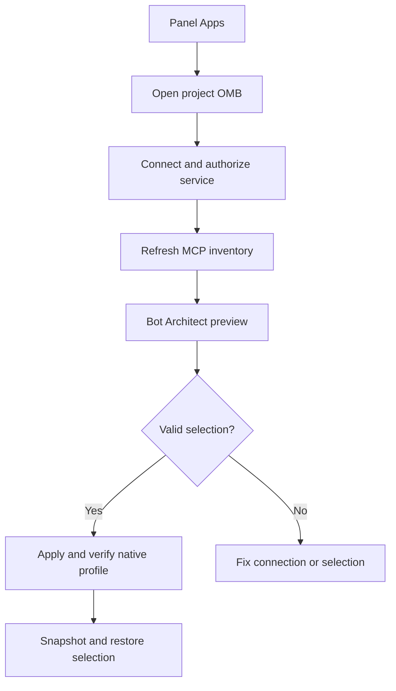

# Native connectors and per-bot tool access

> Recovery notice (2026-11-08): this is a reconstructed historical evidence record. Its PNG captures and live project no longer exist. Only source build and Node tests were rerun; see [recovery limits](../../../docs/connectors-recovery.md).

## Overview

Historical groundwork: the link-out UI shown here was replaced by the
[integrated connector panel](../connectors-panel/README.md). Its screenshots and
results describe the initial delivery; current browser coverage uses that panel.

On 2026-11-07, OpenMausBot 0.1.141 accepted native MCP setup and versioned bot tool
selection on a disposable local project. The real panel, Caddy, Dagu and OMB were
used. No external account authorization or business write was performed.

## Contents

- [User flow](#user-flow)
- [Acceptance matrix](#acceptance-matrix)
- [Visual evidence](#visual-evidence)
- [Automated validation](#automated-validation)
- [Scope and limitations](#scope-and-limitations)
- [Handoff signals](#handoff-signals)

## User flow



## Acceptance matrix

| Scenario | Expected result | Status | Evidence |
|---|---|---|---|
| Native custom MCP | OMB connects to a harmless stdio fixture | ✅ | `check-connectors-live.cjs` |
| Inventory | Native and project MCP names, no endpoints or credentials | ✅ | Node checks; real panel |
| Bot create/update | Native preview/apply persists requested `tools` | ✅ | Real Dagu workflow and native profile readback |
| Restricted MCP access | Codex retains `native:*`; other MCP tools excluded from selection | ✅ | Real native scope readback |
| Disabled connection | Previously prepared apply fails after disabling its server | ✅ | Real Dagu workflow |
| Replay | Completed apply returns its original receipt | ✅ | Real Dagu workflow |
| Snapshot/restore | Rendered native snapshot restores the fixture's tool selection | ✅ | Native team apply and independent API readback |
| Other bots | Native IDs preserved through fixture CRUD | ✅ | Real roster comparison; no broad prune |
| Role defaults | Framework bot selections accepted by pinned OMB | ✅ | Native team apply; doctor matches declared bots |
| Panel | ES/EN, mobile layout, project OMB link, failed refresh clears inventory | ✅ | Browser smoke below |
| Self-hosted Composio | Only explicit project secret maps to server environment | ✅ | Shell fixture test; pinned source inspection |
| External OAuth and business tool call | Authorized account completes sign-in and tool execution | ⚠️ | Not exercised; no external test account supplied |
| Native-only connection restore | Connection definition recreated from Git | ⚠️ | Not implemented; inventory labels native-only definitions |

## Visual evidence

### Desktop inventory

<details>
<summary>Show the real local panel</summary>

Automated Playwright capture of the real panel after the Dagu inventory workflow
returned the declared `dagu` and `fyso` servers. The action opens this project's
OMB gateway; declared configuration is distinct from tested connectivity.

> Historical capture unavailable after recovery: `connections-desktop.png` — Project MCP inventory and native OMB connection entry.

</details>

### Mobile layout

<details>
<summary>Show the 390 px viewport</summary>

The same real inventory wraps within the mobile viewport. The executable check
asserted no horizontal overflow and tested English after returning to desktop.

> Historical capture unavailable after recovery: `connections-mobile.png` — Mobile connector inventory without horizontal overflow.

</details>

## Automated validation

Commands are run from this repository unless stated otherwise. The native test
requires an explicitly selected disposable Copier project without remotes and
`project/connector-proof.cjs` copied from `tests/fixtures/connector-mcp.cjs`.
Its local fixture Git commits are part of the existing architect/snapshot contract.

```sh
node --test tests/*.test.cjs
# Passed: 62 tests. Final targeted checks after inventory hardening: 17 passed.

# In a disposable generated project, with its encrypted secrets loaded:
FYSO_TEST_CONNECTORS=1 mise exec -- node "$FRAMEWORK_CHECKOUT/scripts/check-connectors-live.cjs"
# Passed: native MCP handshake, create/update, MCP exclusion, completed-plan replay,
# disabled-connection rejection, snapshot restoration and unrelated bot ID preservation.

FYSO_TEST_PANEL=http://panel.localhost:19540 node tests/connections-browser.cjs
# Passed: real inventory, native gateway HTTP 200, ES/EN, mobile overflow=false,
# injected enqueue failure clears prior inventory, pageErrors=0, two screenshots.

npm --prefix template/framework/panel run build
# TypeScript and production build passed.

# In the disposable generated project:
mise run doctor
# All checks passed, including native instance identity and declared bot match.

git diff --check
bash scripts/check-paths.sh
# Passed.
```

The pinned Dagu 2.24.0 MCP was initialized and queried with `tools/list`; it exposed
`dagu_change`, `dagu_execute` and `dagu_read`. The operator default therefore uses
real tool names. Native OMB rejected a Codex selection without `native:*`; after
retaining native tools, its explicit MCP selection passed.

Python bot-import, snapshot-sidecar and Builder regressions: **15 passed** with
the fixture's pinned tool PATH. A broader Python run was not green: installer
localization lacked newly added tool labels, an extension fixture inherited a
different SOPS key, and a concurrent tray change raised `NameError: Path` in a
later focused run. These are outside the connector changes; no full-suite Python
success is claimed. Initial sandbox socket failures were retried outside the
sandbox; they are not counted as functional passes.

## Scope and limitations

- Browser coverage is automated. Only its final failed enqueue response is
  deliberately injected; normal inventory and gateway access use real services.
- Native tool selection/configuration is verified; an LLM-driven external tool
  call and OAuth refresh are not verified by these tests.
- Connected-app account/toolkit grants stay in native OMB Access settings. The
  inventory lists MCP servers, not Composio account identities.
- Existing project-owned team files are preserved by Copier. Defaults affect new
  projects; existing bot access changes require an explicit reviewed update.
- The disposable stack was generated from the working template during this task.
  Concurrent web-auth, extension-page and tray changes are separate work and are
  not claimed as accepted by this connector evidence.

## Handoff signals

Use [the connector contract](../../../docs/connectors.md) for the configuration
and restore boundaries. Local development evidence does not imply CI, deployment
or external account acceptance. The disposable stack is stopped after validation.
