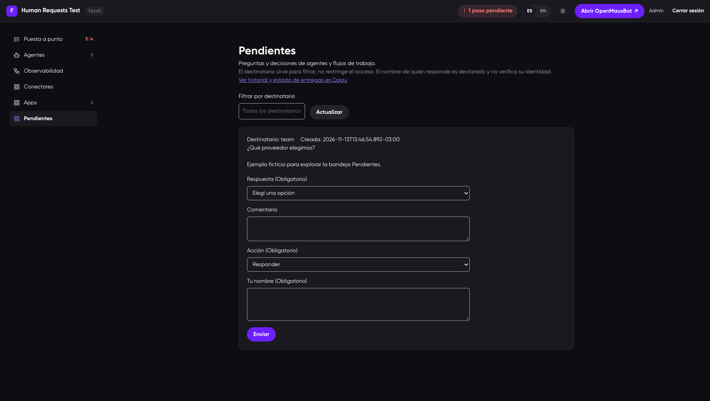

# Human requests — local validation

## Overview

An experimental extension lists human requests and accepts responses in a generated local project. The authenticated browser flow was manually checked against Dagu 2.24.0. This is not a production or OpenMausBot conversation acceptance.

## User flow

An agent or program starts a request workflow. A person opens Pending, reviews the prompt and choices, enters their name and responds. Dagu saves the answer and queues the workflow's delivery step. The responder name is self-declared and the recipient is a filter, not an access restriction.

## Acceptance matrix

| Scenario | Status | Evidence |
|---|---|---|
| Authenticated list, detail and response | ✅ | Manual Chrome, local generated project, Dagu 2.24.0: GET list/detail and POST completion returned 200; saved message displayed, no console errors or warnings. |
| Workflow result and expiry | ✅ | Local Dagu 2.24.0: answer and expiry workflows succeeded; an identical second answer was accepted idempotently. |
| Continue OpenMausBot conversation | ⚠️ | Not verified against a real conversation. |
| Authenticated engine | ⚠️ | Not tested; doctor used explicit failing wrappers for engine login checks to avoid inspecting personal credentials. |

## Visual evidence

The screenshot shows the local Pending screen and a fictional request. It was captured manually during the earlier browser check using Dagu 2.25.2; the later 2.24.0 retest is described above.

## Automated validation

`node --test tests/human-requests-extension.test.cjs tests/human-requests-panel.test.cjs`: 8 passed. Copier 9.19.1 generated the extension into a temporary project; `mise run ext:add` installed it in a separate generated stack.

## Scope and limitations

The generated stack required a project-local PATH adjustment to select Dagu 2.24.0; the underlying framework PATH issue was not changed here. Doctor was not fully green: two engine authentication checks were deliberately failed, while service and isolation checks passed. HTTP callbacks are disabled. Options are validated in the page, not on direct Dagu API calls. No end-to-end delivery to an OpenMausBot conversation or external system was demonstrated.
