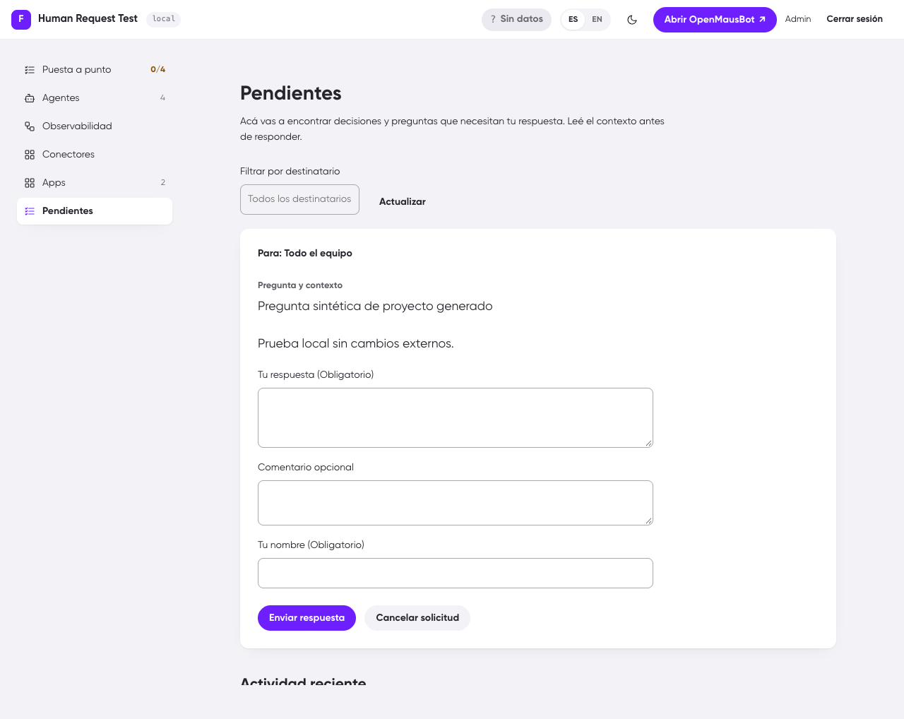
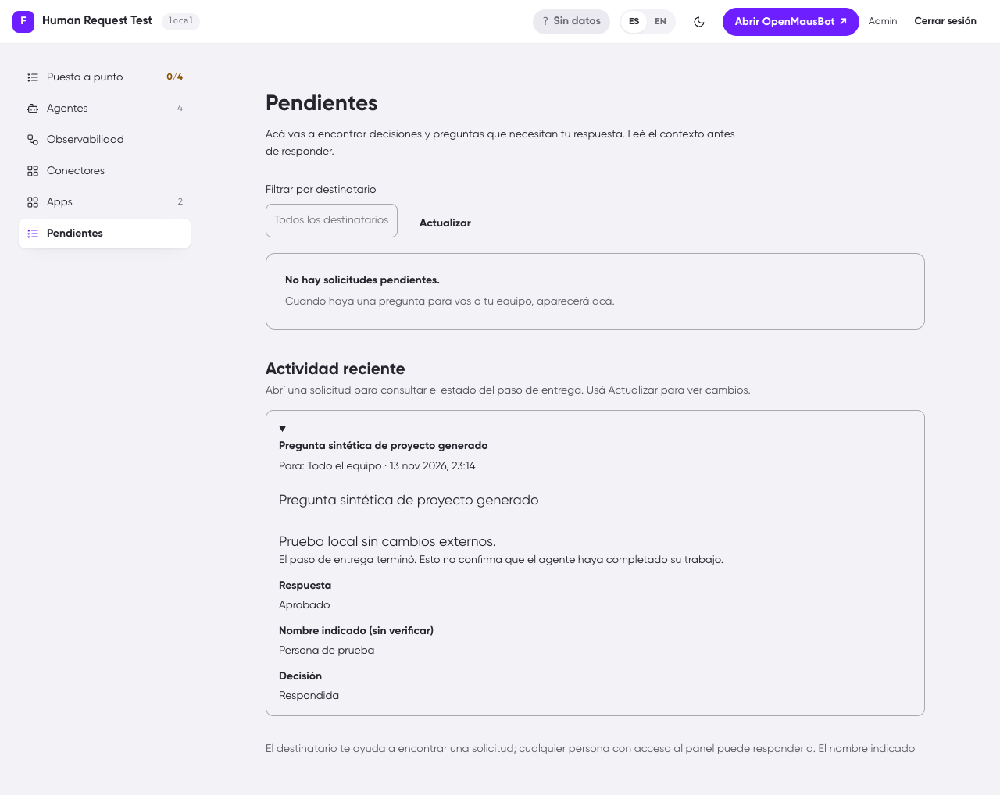

# Generated-project panel and gateway test

On 2026-11-14 UTC, an isolated fixture used Copier 9.19.1 to generate a project and install its bundled human-requests extension. It generated the real panel inventory and served the generated panel through isolated Caddy 2.11.9 and Tinyauth 5.2, with Dagu 2.24.0 and a disposable Chromium profile. No mise command or existing browser session was used.

A fictional `origin=none` request appeared under the actual **Pending** navigation entry inside the extension iframe. A separate browser login and completion returned HTTP 200. Dagu's outputs contained the answer and self-declared responder; the activity card showed them after a reload. The fixture reported no page errors. Its dedicated process groups stopped at the end. The cleanup helper was also tested with a group leader that had exited while a descendant remained, and with an intentional early fixture failure.

A separate run of the same generated-project fixture cancelled a request through the panel without an answer. The completion returned HTTP 200, Dagu recorded `decision=cancelled`, and the history showed **Cancelada** after reload.

The Dagu server used a copy of the installed request workflow to avoid starting unrelated schedules. The test starts Dagu directly and does not exercise `mise run up`, the generated project's full stack, OpenMausBot, an actual person, or `mise run doctor`. It does not claim that a submitted answer caused an agent to complete work. Browser request interception is not an operating-system firewall for Chromium's internal traffic. The test checks that fixture listeners belong to its own process groups before requests and uses a random run ID plus an absence check for Dagu's Unix socket, but port and socket checks still have a time-of-check/time-of-use window. Filesystem reads are not sandboxed. The tools, source and test data used here are trusted and fictional.

To reproduce on macOS, provide the pinned tools and a disposable artifact directory through `FYSO_TEST_SOURCE`, `FYSO_TEST_COPIER`, `FYSO_TEST_DAGU`, `FYSO_TEST_CADDY`, `FYSO_TEST_TINYAUTH`, `FYSO_TEST_CHROME`, `FYSO_TEST_NODE_DIR`, `FYSO_TEST_YAML_DIR`, `FYSO_TEST_ARTIFACT_DIR`, and a `NODE_PATH` containing Playwright; then run `node tests/human-requests-generated-gateway.cjs`. Set `FYSO_TEST_CANCEL=1` to exercise cancellation. The focused cleanup test is `node --test tests/human-requests-generated-gateway-cleanup.test.cjs`. Do not point the test at an existing project's services or data.
