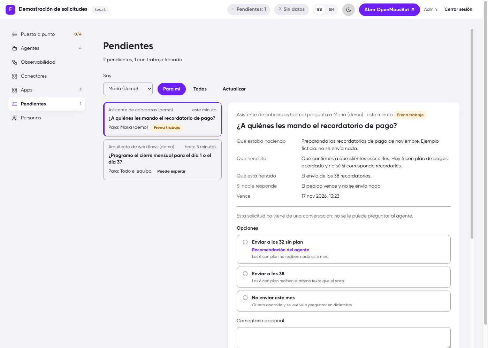

# Inbox, structured requests, questions to the agent and the menu counter

Date: 2026-11-14. Local observations on disposable projects with fictional, non-sensitive requests. Not CI or release evidence.

## What was run

| Scope | Observation |
| --- | --- |
| Unit and real Dagu 2.24.0 | `node --test tests/*.test.cjs` with `FYSO_TEST_DAGU` set to the pinned binary: 194 passed, 9 skipped, none failed (they need the pinned age and SOPS binaries). `human-requests-clarify-dagu.test.cjs` runs the new workflow on an isolated Dagu: an incomplete request and one whose options differ from its label fail before reaching a person; a request shows its card; two questions go to a stand-in bot CLI and their replies accumulate on the card; the decision is delivered once. |
| Browser, running generated demo project | The project's extension files, panel build and inventory were replaced in place with this version. Signed in through the real gateway: the top bar showed "Pendientes: 2" and the menu showed 2 beside Pending, on a non-request screen too; the inbox listed the request that holds up work first; choosing a person, an option and a comment and sending recorded `answered` with those values in the run's outputs and the run finished; the counter dropped to 1 at once. The People page, now an extension page, listed the person created through Dagu's wiki API. |
| Generated project, real bot | On the fully generated project with its own OpenMausBot 0.1.141 (bot on the Codex engine), the extension's files were replaced in place. A request addressed to the bot's existing conversation was created through Dagu's API. A push-back with a question returned the bot's reply on the card in 12 seconds, using facts given earlier in that conversation. After the decision, the delivery step succeeded and the conversation shows the decision message followed by the bot's continuation. |

## Limits

- On the Codex engine the bot cannot create the request itself, because Codex bots do not see the project's MCP servers; that is a problem of the engine integration, not of this extension. On the Claude engine a real bot created its own request, answered a question and continued after the decision ([follow-up](generated-codex-blocker.md)).
- The projects were updated by copying files, not through `ext:update` or `copier update`; the bundled extension still has no versioned source.
- The browser and gateway scripts written for the previous page (`human-requests-*-browser.cjs`, `human-requests-gateway-history.cjs`, `human-requests-generated-gateway.cjs`, `people-wiki-browser.cjs`) had their request parameters updated but were not rerun; their selectors target the previous page and the removed core People screen.
- Python integration tests, installers and `mise run doctor` were not rerun after these changes.
- The counter is for the project, not for a person. Recipient labels do not restrict who can answer, and the responder's name is self-declared.
- No non-technical person has tried it.
