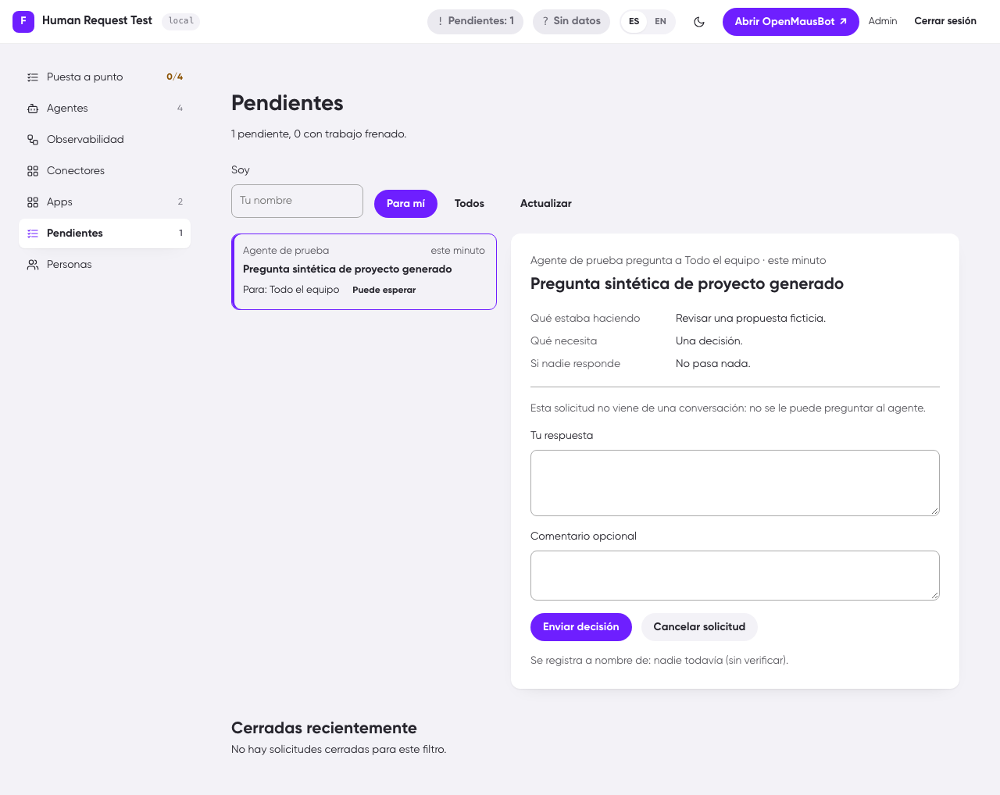
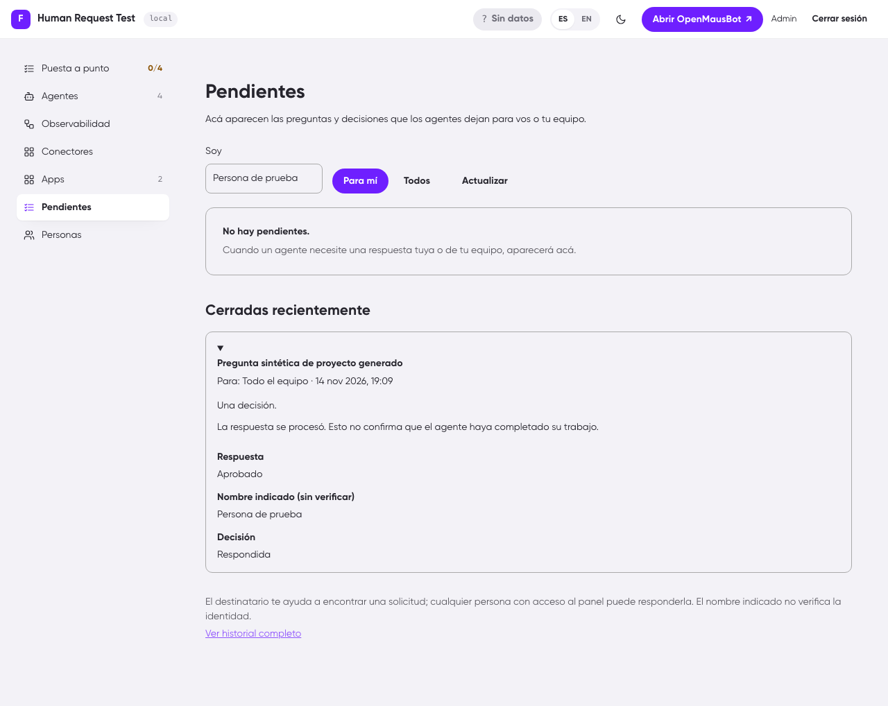
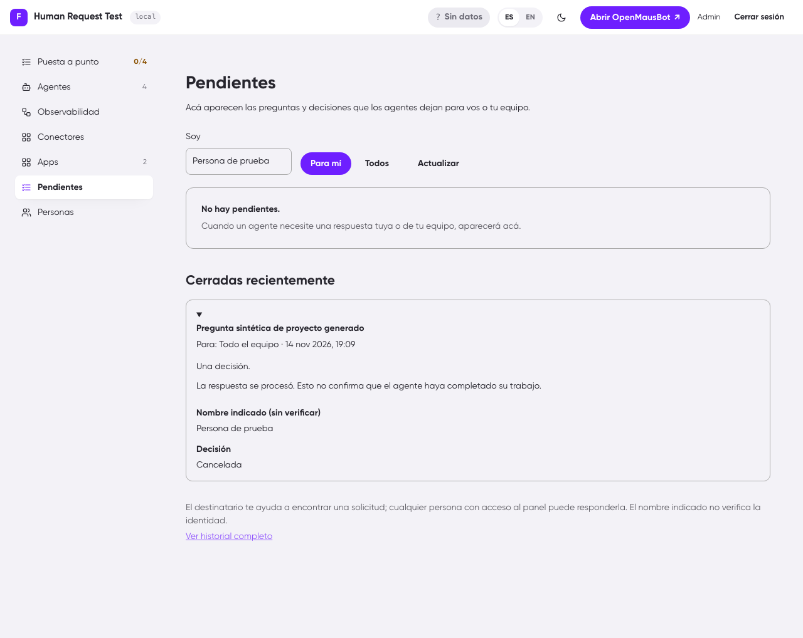
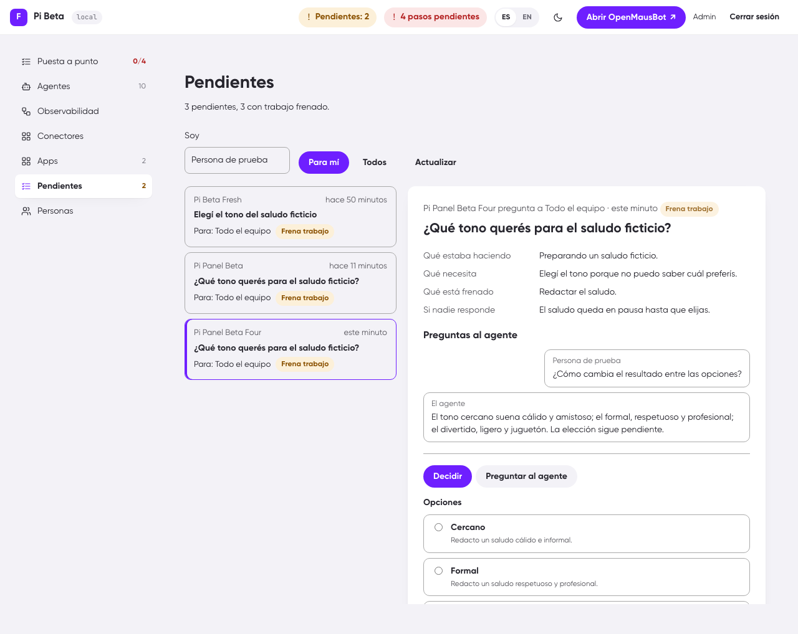
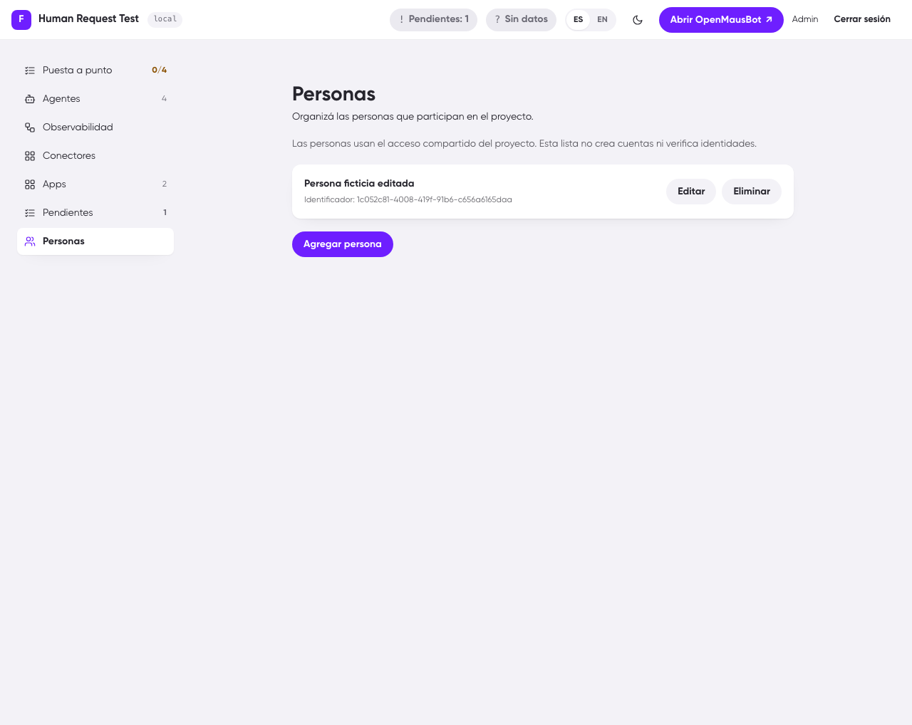

# Pi and ChatGPT beta validation

Status: **full generated-stack lifecycle passed once on macOS (2026-11-14)**; distribution limits below remain.

## Full lifecycle acceptance

A reviewed controller ([controller](../../../tests/pi-lifecycle/controller.py), [profile](../../../tests/pi-lifecycle/profile.sb.in), [browser step](../../../tests/pi-lifecycle/browser.cjs)) generated a project from the uncommitted working tree with Copier 9.19.1 and `engine=pi`, then ran the normal `mise run setup`, installed the bundled extension from `./framework/extensions/human-requests`, `mise run up`, `mise run doctor` (running-stack branch, [log](lifecycle/pi-lifecycle-doctor.log)), the real Pi bot flow and `mise run down`, all inside the [rendered sandbox profile](lifecycle/pi-lifecycle-profile.sb). A new Pi bot with only `dagu_read`/`dagu_execute` created a fictional request with its exact OMB origin; in the authenticated panel the fictional person asked a question, got the bot's answer ([capture](lifecycle/pi-lifecycle-clarification.png)), decided ([capture](lifecycle/pi-lifecycle-decision.png)); Dagu finished `succeeded` and the bot replied in the same conversation. After shutdown: no fixture processes, ports, fixed sockets or Dagu sockets remained, and the recorded global mise, Pi, Git and `/tmp` state was unchanged ([sanitized result](lifecycle/pi-lifecycle-result.json)).

Conditions and limits:

- Option A: every other Dagu on the host (the personal launchd one and leftover fixtures) was stopped for the run, because Dagu 2.24 hard-codes `/tmp/@dagu_<name>_<md5(name+runID)[:6]>.sock` and removes that path before binding; the controller refused to start with another Dagu and watched for one during the run. The personal Dagu was restored afterwards.
- The first run passed functionally but left `/tmp/fyso-mcp-<port>.sock`: the remote MCP server had no SIGTERM handler. It now closes its server on SIGTERM/SIGINT (regression test in `tests/fyso-mcp.test.cjs`); the second run was clean.
- The Tinyauth binary was copied prebuilt and tools were symlinked read-only from the existing mise installs; installing them was not exercised. Reads are not isolated. Hosts on the local network at :443 remain reachable.
- Expected sandbox denials: dtrace helper noise, OpenMausBot probing local model ports, `security` (so doctor reports Claude/Codex as signed out) and Pi's `models-store.json.lock`; the flow passed without them.
- One run on one macOS host. Not Windows/Linux, not an interactive GUI install, not a published extension source. The Codex CLI integration remains unresolved; Pi is the working engine.

The [independent review packet](independent-review.md) identifies the unreviewed isolation changes, focused checks and decision still needed before a full lifecycle test.

## Real model and MCP

In an isolated OpenMausBot 0.1.141 and Dagu 2.24.0 fixture, a bot used Pi 1.5.2 and the user's existing ChatGPT OAuth login. Native Pi `set_model` confirmed `openai-codex/gpt-6-luna`. No credential values were printed or copied.

The bot called the scoped Dagu MCP. With the scoped text-compatibility change installed in that fixture, a new conversation read the previously completed run and reported `succeeded` from the actual tool result. Its tool selection contained the project server; the project Pi launcher disabled Pi's own MCP and extension discovery. This verifies that particular scoped read, not every MCP tool or an OS security boundary.

An earlier version of the fixture completed a fictional human request: the bot created a request, answered a question in 8.5 seconds while it remained waiting, and continued in the same conversation 5.2 seconds after the decision. In that earlier run, some structured Dagu results were hidden and the operator independently checked the state; the complete flow has not yet been repeated after the compatibility change without operator guidance. The fixture used explicit paths and environment variables; it was not a normal generated-stack installation.

In a later generated-project component test, a fresh Pi bot received the skill through its native team configuration, with no skill text or origin IDs in the prompt. It read the skill and created a fictional request that reached Dagu's waiting state. The first attempt revealed that a nested `REQUEST` object is converted to non-JSON by Dagu; the skill now explicitly requires a JSON string. The bot chose `ORIGIN_TYPE=none` because it did not know its exact conversation identity, and stated that clarification was unavailable. Therefore this does **not** establish autonomous same-conversation resumption. The scoped tool advertised arguments the guard rejected; its advertised execute schema now excludes those arguments while the guard continues to reject them. The bot recovered from both rejections during the test.

OpenMausBot 0.1.141's native `list_threads` output lists thread IDs but does not label the caller's current thread. More than one thread can be active, so selecting the newest or a running row would not establish its identity. With the agents server explicitly selected, its native, per-turn Pi MCP descriptor includes the bot and thread IDs. A project Pi launcher adapter extracts only these validated identifiers and supplies them as context; it never prints or forwards the descriptor's bearer token. This depends on an internal descriptor shape of the pinned OpenMausBot version and fails closed if the agents mount or IDs are missing. New Pi team definitions allow `agents:list_threads` so OpenMausBot mounts that server; this also grants the native read-only thread-list tool, which is a material change to their tool scope. Existing project-owned team files require an explicit update.

The agent editor now adds that specific selection to an existing allow-list when the human-requests skill is enabled for Pi, and explains the visibility in the UI. An explicit denial remains untouched and produces a warning; a list already at OMB's 256-selector limit is also left unchanged and reported as unavailable. Unit tests check preservation of other selectors, denial precedence and that limit; the panel build and typecheck pass. Three isolated browser fixtures exercised the form: the review draft contained precisely the added selector when enabling the skill and when switching an existing skilled agent to Pi; a third retained the explicit denial with a visible warning. These used a mock backend and did not apply changes to a real agent. Applying a team change still uses the existing project review flow.

With that adapter and the skill installed through native team configuration, a new Pi bot created a fictional request with an OMB origin, without receiving the skill text or IDs in the prompt. The saved origin's bot and task IDs matched the native send receipt. The request reached waiting and offered clarification. The person fixture asked a question; the bot answered and the request remained waiting. The person fixture then chose an option, Dagu completed successfully, and the bot wrote the resulting greeting in the same conversation. This was a real ChatGPT-backed turn with separate generated Dagu and OpenMausBot components in a sandbox, using API calls for the person fixture; it does not establish authenticated panel UI or full-stack lifecycle acceptance.

## Generated-project components

Copier 9.19.1 generated a temporary project with `engine=pi`. Its team declares Pi models from `openai-codex`; the separate Builder workflow still chooses Codex as its supported coding harness. Pi 1.5.2 was installed in an isolated temporary mise data directory. The real `mise run setup` completed with a fixture-only age identity and fictional login under a macOS sandbox that denied network and writes outside the fixture.

The generated project's `run-omb.sh` then started only its own OpenMausBot under a sandbox that denied other TCP destinations and external writes, except Pi's temporary lock directories needed to read existing local authentication and settings. The native Pi engine was available and listed the expected ChatGPT model. Updated uncommitted framework scripts had been copied into the fixture before this isolated component test. A second project was generated from the current uncommitted template and seeded with the first fixture’s synthetic encrypted configuration. Its Dagu and OpenMausBot were then started separately in a restricted sandbox: the normal managed-MCP restore registered the project-owned `dagu` entry, its native probe succeeded and the server was enabled without storing credentials in the project definition. This is not proof that normal full-stack startup, doctor, login UI, installer or extension lifecycle passed.

A Dagu 2.24.0 canary checked that XDG and explicit mise data, cache and state locations reach a workflow step, while unrelated secret and age-key canaries do not. A separate macOS sandbox canary ran an innocuous `mise exec` child with network and external writes denied. The outstanding independent review and full lifecycle isolation plan remain applicable; no unrelated project services were started or stopped.

The new doctor component check was also run against that fixture's live OpenMausBot and Dagu: the project-owned `dagu` server was enabled and the native probe returned both read and execute tools. The check verifies the expected project script and refuses a personal server or server-level environment overrides. After Dagu was stopped, the same check failed even with previously cached tools available. Unit tests also reject a definition pointing at another project. This is not a complete `mise run doctor` or a per-bot visibility test.

The generated project's actual `mise run doctor` also passed in **stack-not-running mode** with only its isolated connector-setup component running. It checked the encrypted fixture configuration, installed tools, existing Pi login, explicit OMB target and free port block. As a negative control, a fixture listener occupied the project's panel port and doctor failed with that port marked in use. The connector and its Unix socket were removed afterward. This does not exercise doctor's running-stack branch, gateway, or live MCP check, and does not replace the required full-lifecycle acceptance.

An authenticated browser test subsequently generated a new project and installed the bundled extension, then started only fixture-owned Dagu 2.24.0, Caddy 2.11.9 and Tinyauth 5.2.0 components. With real login and gateway routing, a fictional request was answered in the panel and its saved result appeared after reload; a second independent run verified cancellation and its history. Both runs had zero page errors and stopped their own process groups. The components and browser ran in a write-restricted sandbox; an external local supervisor checked listener ownership and cleaned up the fixture processes. OpenMausBot was not part of these two runs, and both requests used `origin=none`.

A third isolated run verified the people directory through the authenticated gateway and real Dagu wiki: it created a fictional person, edited the name without changing its ID, checked persistence after reload and deleted that fixture record. It also completed the fictional request and stopped its own service groups. The older browser test was updated to address the extension iframe and its inline delete confirmation.

A further integrated component test ran the generated project's Dagu, OpenMausBot, Tinyauth and Caddy separately in an isolated fixture. A real Pi bot using ChatGPT created a fictional request from its installed skill. In the authenticated panel, the person fixture asked a clarification and received the bot's answer, selected an option and submitted it. Login, push-back and decision each returned HTTP 200; Dagu finished successfully; and a new, completed bot response after the decision contained the requested greeting in the same conversation. The test waited for the completed bot turn before stopping its own services. The [sanitized results](pi-beta-integrated.json) record the observed values. This is not a `mise run up` or `mise run doctor` acceptance.

An earlier integrated attempt stopped its fixture immediately after the panel's HTTP 200 response, before the asynchronous delivery finished, so that attempt's delivery failed and was not counted as a pass. The final test used a new fictional request and waited for both Dagu's success and the bot's completed turn.

### Authenticated panel evidence

The automated local fixture used a synthetic account and request. Login and the human-task completion each returned HTTP 200; no browser page errors were observed. These captures show the real gateway and Dagu-backed panel, without an OpenMausBot return target.

**Pending request.** The person can inspect the request and choose to answer or cancel. The notice correctly says that this particular fixture has no conversation to ask.

**Answered request.** After submission and a page reload, recent history shows the recorded answer and self-declared responder.

**Cancelled request.** A separate test run shows cancellation in recent history after reload.

**Real Pi clarification.** In the integrated component test, the authenticated panel shows the actual bot's answer to the fictional person's question while the decision remains pending. Other rows are earlier fictional requests from the same disposable fixture.

**People directory.** The authenticated panel shows the edited fictional person with its stable ID; the test then removed that fixture record.

## Automated checks

- Full Node suite: **216 tests, 205 passed, 11 skipped, 0 failed**. This is local evidence, not CI. The scoped-schema, turn-origin, form-selection and offline Dagu discovery regressions separately failed before their changes and passed afterward.
- The pinned Gitleaks 8.30.1 directory scan reported no leaks in the working tree; this is a local scan, not a guarantee about every possible secret format.
- Python: **25 tests passed** across the supervisor, diagnostics, isolated Dagu environment and Qt installer tests. A separate supervised test generated a project with Copier, installed the bundled extension and completed a fictional request with real Dagu and `origin=none`; it passed after updating its expected preparation step and card output.
- An isolated real-Dagu history test passed for answered, cancelled and expired fictional requests after deliberately failing delivery; the exact saved answers, including Unicode and shell-like text, were retained. Its fixture was updated for the current preparation step and card output.
- The opt-in macOS sandbox boundary probe passed with fake files, fixture ports and DNS enabled: the selected lock and port worked while a sibling path and other port were denied. An HTTPS-like wildcard allowance also denied unrelated loopback on IPv4 and IPv6. It does not replace independent review or prove the full lifecycle sandbox.
- Qt installer backend: **13 tests passed**, using temporary fixtures and mock installation commands. If Pi is signed out, its log now gives the project-specific sign-in and doctor commands without displaying a password.
- Qt wizard contract: **5 tests passed**, including Pi selection; this is not a real GUI test.
- Installer, packaging and tray contracts: **17 tests passed**. The macOS installer initially lacked labels for the newly pinned Pi step in both languages; those labels were added. This does not prove an interactive or clean-machine installation.
- Copier installation and panel inventory passed in a no-network fixture. A separate local Git fixture tagged successive versions of the actual bundled extension and successfully ran both `ext.sh apply update` and `ext.sh update`, preserving an unrelated file. On macOS this exposed an isolated-temp-directory failure: the panel update now supplies an explicit template under `TMPDIR`. The fixture does not publish an extension, and the bundled source still has no independently versioned release.
- Synthetic headless-browser recipient filtering passed both with and without a people directory. A separate synthetic panel flow passed for entering a name, asking a question, reading its answer and deciding. Both used a temporary browser profile and mocked APIs. The older history browser fixture targets an earlier panel design and has not passed against the current UI.
- The Pi MCP regression failed before the scoped change and passed afterward. A separate model-repair regression failed before the provider-preservation check and passed afterward.

## Remaining acceptance

- Repeat bot-created request, clarification and continuation with the pinned Pi executable, registered project skill and generated project configuration, without injecting the skill or independently substituting for tool results.
- Extension installation and both update paths have fixture coverage, but the bundled extension has no independently versioned source yet.
- Run appropriate installer smoke tests and document actual behavior on supported hosts. Do not claim Windows or a clean-machine installation from the Qt contract tests.
