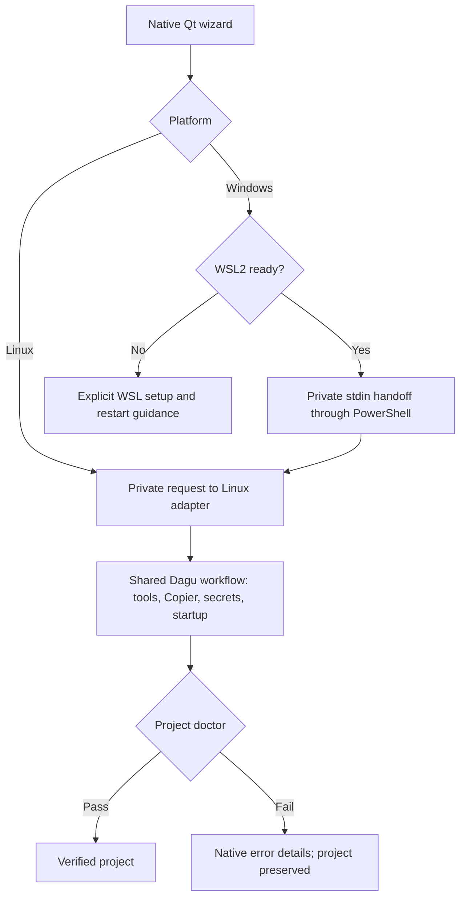
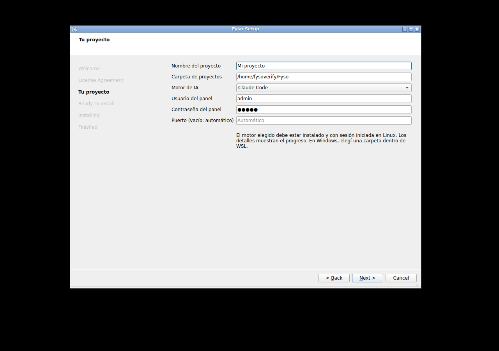
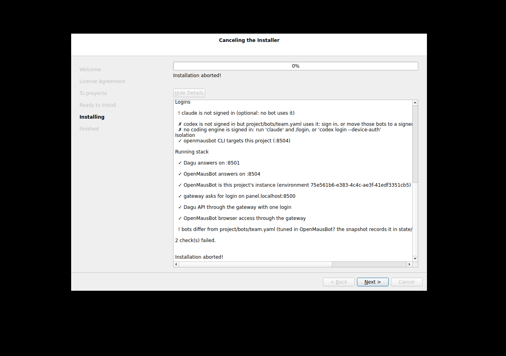

# D38 — Linux and Windows installer evidence

## Overview

Qt Installer Framework now provides the native wizard and build recipe for Linux and
Windows. The Linux wizard ran the shared Dagu workflow in an isolated Ubuntu 24.04
ARM64 VM: the real stack started and all three authenticated routes returned 200.
Doctor correctly failed two login checks because the fixture has no coding-engine
subscription credentials. Windows adapter execution was tested with PowerShell and an
executable WSL shim; no native Windows host or `.exe` acceptance was available.

Validation date: 2026-11-07 UTC. No personal Dagu, OpenMausBot or agent sessions were used.

## Contents

- [User flow](#user-flow)
- [Acceptance matrix](#acceptance-matrix)
- [Visual evidence](#visual-evidence)
- [Automated validation](#automated-validation)
- [Scope and limitations](#scope-and-limitations)
- [Handoff signals](#handoff-signals)

## User flow



## Acceptance matrix

| Scenario | Expected result | Status | Evidence |
|---|---|---|---|
| Native Linux build | Qt produces an ARM64 `.run` | ✅ | [Native build](#native-build-and-runtime) |
| Wizard form | Defaults, engine, editable folder and masked password | ✅ | [Linux form](#linux-form) |
| Real Linux runtime | Panel, Dagu and OMB authenticate successfully | ✅ | [HTTP signals](#native-build-and-runtime) |
| Wrong password | Gateway rejects it | ✅ | HTTP 401 in the fixture |
| Missing engine login | Doctor fails visibly; project remains | ✅ | [Prerequisite failure](#prerequisite-failure) |
| Complete Linux acceptance | Doctor green with a real engine login | ⚠️ | No engine account in the VM |
| Secret handoff and cancellation | No password argument; temporary files cleaned; owned child work stopped | ✅ | Unit/protocol tests plus 0 remaining password files in the VM |
| Windows adapter | Unicode, spaces, WSL2 check and exit-code propagation | ✅ | Actual PowerShell with disposable `wsl.exe` shim |
| Native Windows | `.exe`, UAC/restart, actual WSL2 and browser routing | ⚠️ | No Windows host; workflow defined but not run |
| Clean Linux distribution support | Binary dependencies satisfied without compatibility setup | ⚠️ | ARM64 IFW binary needed isolated older libraries |

## Visual evidence

### Linux form

<details>
<summary>Native Qt form, inspected manually in the isolated Linux desktop</summary>

The final Linux binary displays localized Fyso fields, populated defaults, an editable
project folder and a masked test password. The fixed wizard size prevents the
help text from being clipped. The standard Qt navigation uses the VM's system locale.
This capture proves the final form, not successful installation or engine login.

<p align="center"></p>

</details>

### Prerequisite failure

<details>
<summary>Real doctor result shown by the native Qt error flow</summary>

The native smoke ran the real install workflow. Qt's details show missing Codex login,
matching project isolation, and successful gateway/OMB/Dagu checks. The installer
reports failure rather than declaring a ready project without authentication.
The generated project and running stack remained intact after Qt rolled back only
its helper files. This screenshot intentionally records a prerequisite failure.

<p align="center"></p>

</details>

## Automated validation

### Regression suite

```sh
node --test tests/*.test.cjs
mise exec npm:yaml@2.8.1 aqua:gitleaks/gitleaks@8.30.1 -- python3 -m unittest discover -s tests -p 'test_*.py'
```

Observed: **46 Node passed; 56 Python collected, 43 passed and 13 skipped**. The skips
belong to existing integration fixtures with unavailable prerequisites. The existing
tray tests emit file-handle ResourceWarnings; no test failed. Tests used temporary
projects and process/socket fixtures, not production or subscription accounts.

Targeted coverage: private request permissions; password removal on Dagu failure;
project retention on doctor failure; unique slugs and port reservations; extension
block overlap; Windows host port exclusions; Windows stdin EOF cancellation;
PowerShell Unicode and path escaping; WSL1 rejection; native child exit propagation;
and GNU base64 folding for long Dagu credentials.

### Native build and runtime

The public Qt 4.7.0 ARM64 tool archive was verified against Qt's published checksum.
The build used its real `binarycreator` and the worktree's build script:

```sh
python3 installer/qt/build.py --target linux --ifw-root "$IFW_ROOT"
```

Result: `Fyso-Installer-linux-aarch64.run`, approximately 50 MB. Qt runtime: IFW 4.7.0,
Qt 6.6.0. The Ubuntu 24.04 ARM64 VM required isolated compatibility libraries for
`libtiff.so.5` and `libwebp.so.6`; no system libraries were replaced.

Native smoke (one isolated project, no retries inside the test):

```sh
FYSO_SOURCE="$FIXTURE_TEMPLATE" FYSO_REF=main \
  "$INSTALLER" --verbose --script tests/fixtures/qt-installer/smoke.qs
```

The fixture is a local Git snapshot of this template. Copier generated a separate
project, the pinned tools installed, encrypted secrets were created and the stack
started. A prior failed run exposed use of `sh` for a Bash bootstrap; the adapter now
uses Bash. The final native run reached doctor and reported only the missing engine
login checks. No model conversation or subscription call was performed.

Read-only HTTP checks, against loopback port 8500 with Host headers and disposable
fixture credentials:

| Route | Result |
|---|---|
| Panel `/`, `Host: panel.localhost` | 200 |
| Dagu `/api/v1/dags`, `Host: dagu.localhost` | 200 |
| OMB `/api/bots`, `Host: omb.localhost`, browser-style header | 200 |
| Panel with a wrong password | 401 |
| Remaining temporary `initial-password` files | 0 |

Native Qt screenshots were captured with X11 `xwd` and converted to PNG. Browser
screenshots are not applicable to the installer wizard; browser routing was checked
through the real HTTP gateway, without claiming an authenticated browser smoke.

## Scope and limitations

- Linux structural installation and routes passed; full doctor acceptance remains open
  until a real selected engine is installed and authenticated. Simulated logins in unit
  tests do not satisfy that gate.
- Windows source, wizard branch, build configuration and PowerShell protocol tests are
  implemented. A native `.exe` has not been built or run here. The manual native-build
  workflow has not been executed remotely.
- Actual WSL2 cancellation, UAC, restart/relaunch, distribution initialization, Windows
  wildcard localhost resolution and desktop-agent registration need a Windows host.
- A native folder-picker experiment rendered blank in this ARM64 fixture. The final
  wizard uses an editable project path and does not ship that unverified button.
- ARM64 Qt binary compatibility remains a distribution gate; the local validation build
  must not be presented as a universally self-contained Linux release.
- Application signing, publishing and releases were not performed. macOS Qt migration
  is outside this change; the existing macOS entry point remains supported.

## Handoff signals

- Implementation: [installer/qt](../../../installer/qt/README.md).
- Qt controls package ownership and rollback; generated projects are outside that tree.
- Main checkout remains separate; publication does not add native platform acceptance.
- The disposable fixture stack and VM are stopped after evidence collection; the
  generated fixture remains on the VM disk for inspection, without account credentials.
