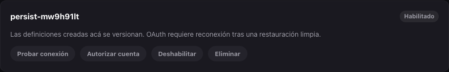

# Managed MCP clean restore proof

## Overview

PR #19's P1 finding is addressed: custom MCP definitions created from the panel
are stored in project-owned native JSON and restored independently of native OMB
state. Authentication headers are encrypted through SOPS; OAuth sessions are not
exported.

## User flow

Add an MCP URL or command from the panel and Save and test. Fyso versions the
non-secret definition and encrypted credential references, probes through native
OMB and enables only a successful probe. Enable/disable and removal update the
versioned source. Restore/up recreate managed definitions before bot selectors.

## Acceptance matrix

| Behavior | Verification | Result |
|---|---|---|
| Create from session-authenticated panel | Real Chromium + Caddy + OMB | Passed |
| Header values absent from JSON/Git plaintext | Native reference and encrypted file assertions | Passed |
| Definition and intended enabled state versioned | Exact-file Git status assertions | Passed |
| Recreate after loss of native server definition | Native DELETE, then restore from Git/SOPS | Passed |
| Restored header authenticates metadata probe | Local HTTP MCP fixture | Passed |
| Removal updates source and native state | Session-authenticated managed DELETE | Passed |
| Git failure rolls back new server, preserving unrelated servers | Unit fixture | Passed |
| Exact origin and private technical authentication | Adapter and native gateway regression tests | Passed |

## Visual evidence

Real isolated stack: the local test MCP was recreated and enabled after its native
definition was deleted. The screenshot contains no header values or credentials.

## Automated validation

`tests/managed-mcp-browser.cjs` runs against an explicitly selected isolated project,
using a private test-login file, a harmless local HTTP provider and a fictional
header credential. Real SOPS and Git are used. It invokes no MCP tools: only native
initialization/tool-metadata probes. The created definition is removed afterward.

Unit coverage: `node --test tests/managed-mcp.test.cjs tests/composio-setup.test.cjs`.

## Scope and limitations

OAuth grants remain native runtime state and require sign-in after a clean restore.
A saved enabled intent does not force an offline/unauthorized server on: restore
probes it and leaves it disabled if authentication/readiness is unavailable. Native
updates failing after a committed enable/removal are reported as failure and can
be retried; no distributed transaction between Git and OMB is claimed. Existing
unmanaged native-only entries are not silently adopted or exported.
