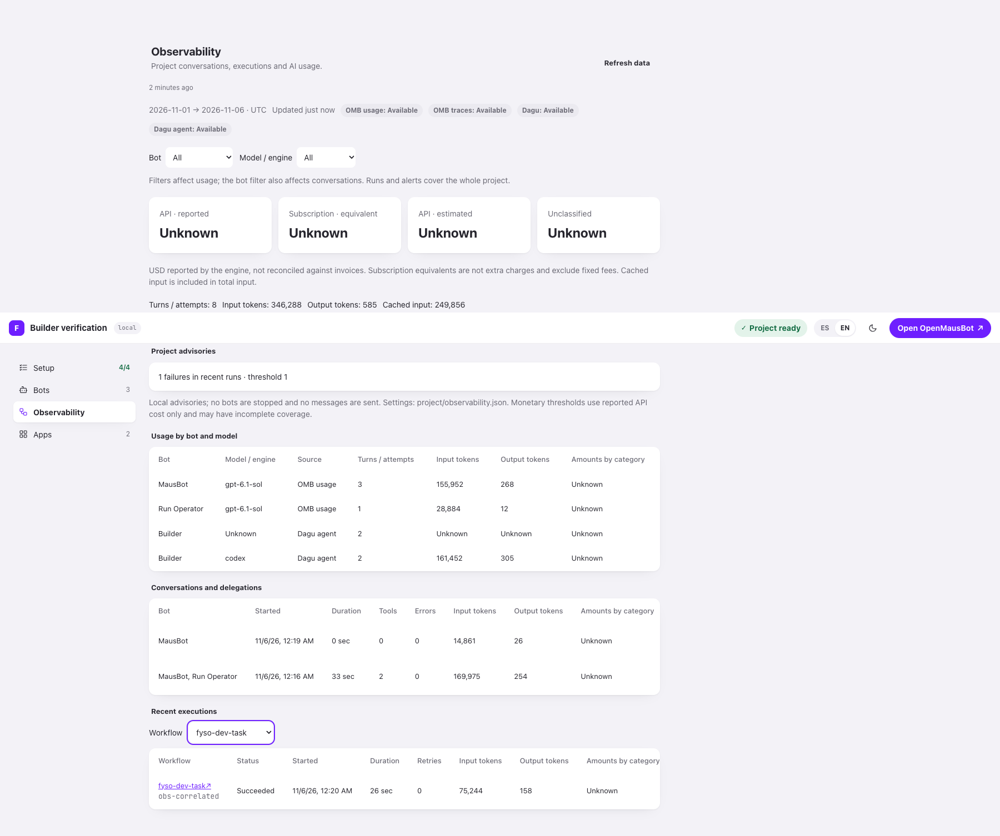

# Bot observability — verified local delivery

## Overview

The project panel now presents conversation activity, native delegation traces,
workflow execution and AI usage without introducing another backend. Costs are
split into API-reported, subscription-equivalent, estimated API and unclassified
amounts. Missing values are visibly unknown, not zero. This work precedes Phase 6.

## User flow

Open **Observabilidad** in the panel. Review source availability and the UTC-month
window, filter usage by bot/model, inspect conversations and filter recent runs by
workflow. Follow native detail links for tools and execution logs. **Actualizar
datos** enqueues the native Dagu exporter; automatic collection runs every two
minutes. Local project thresholds produce advisories, without stopping bots.

## Acceptance matrix

| Scenario | Result | Evidence |
|---|---|---|
| Real conversation and bot delegation | Passed | MausBot → Run Operator; native trace tree, tool count and distinct usage rows |
| Real correlated harness | Passed | `obs-correlated`, Dagu 2.24.0, 03:20:01–03:20:27 UTC; explicit ORIGIN output and 75,244 input / 158 output tokens |
| Cost coverage | Passed | Codex reported tokens but no amount; panel correctly shows Unknown |
| Zero, missing, estimated and subscription amounts | Passed, fixtures | Semantic Node tests; no real metered API charge was generated |
| Restart persistence | Passed | Full isolated stack down/up; identical usage totals, trace identities and run linkage |
| Manual refresh | Passed | Browser click enqueued Dagu; action reached Done and summary updated |
| Empty, unavailable and stale presentation | Passed, fixture | Temporary isolated summary fixture; native records unchanged, real summary restored |
| Access control | Passed | 401 without login, 405 for POST to summary, 200 for authenticated GET |
| ES/EN, light/dark and browser console | Passed, manual | Both locale/theme controls exercised; no console errors/warnings observed |
| User project health | Passed | Applied read-only summary/panel to port block 18400; only Caddy restarted, doctor green |

## Visual evidence

### Real project data

Manual Chrome smoke on the isolated generated project, port block 19240–19249.
The image shows real OMB conversation/delegation usage and structured Codex
harness records. Unknown USD is an actual coverage limitation, not a mock amount.
Test basic authentication was supplied by the browser tool; no provider key,
OMB bearer, prompt, message body or user email is included in the export/image.

<details>
<summary>Observability panel with real conversation and execution data</summary>
<p align="center"></p>
</details>

## Automated validation

```sh
node --test tests/observability.test.cjs
FYSO_TEST_HTTP_PORT=19240 python3 -m unittest discover -s tests -v
npm --prefix template/framework/panel run build
mise run doctor
```

Node semantics: **10 passed**. Python Builder, gateway and observability HTTP:
**16 passed**, with pinned gitleaks on PATH. Panel TypeScript + Vite build passed.
Dagu validated both changed workflows; shell syntax passed. Isolated doctor and
the user's project doctor passed. All runtime actions targeted project-owned
ports and data directories. No remote PR or external telemetry service was used.

## Scope and limitations

- Current-month USD comes from source-reported amounts, not provider invoices.
  Subscription fixed fees and remaining quota are not inferred. The real Codex
  run did not report USD; Claude JSON accounting was verified with fixtures.
- Native instance IDs classify standard billing modes. Custom engine mappings
  belong in `project/observability.json`; unmapped instances are unclassified.
- Existing unstructured harness artifacts remain unknown. Retried artifacts have
  separate attempt identities; re-reading a source never appends duplicate cost.
- Linkage is explicit. Runs without actual thread/turn identifiers remain unlinked.
  Legacy Dagu CLI names are recovered through native artifact metadata and APIs.
- Recent run history is capped at 100 plus CLI artifact-backed runs; native trace
  pagination is capped at 500 and truncation is visible. Monthly ledger totals
  are not computed from those capped views or from trace aggregates.
- OMB memory-maintenance rows without turn IDs retain their native row identities
  and are included. No conversation bodies or arbitrary raw logs are exported.
- History survives restart, not deletion of `.data`. Retention/backup belongs to
  deployment; runtime history is deliberately excluded from git snapshots.
