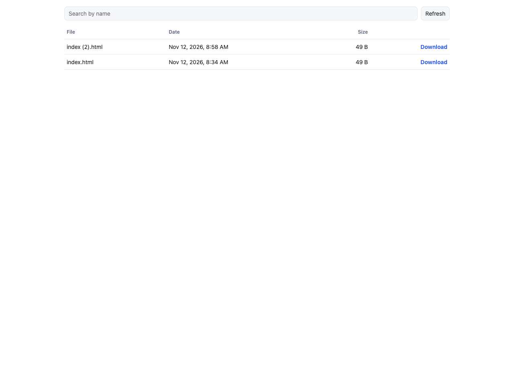

# Owner extensions — final integration acceptance

## Overview

A disposable macOS project installed all six opt-in bundles with the reviewed fixes. The final follow-up corrects the ops doctor's synthetic self-test to satisfy the shared freshness contract without weakening cost evaluation. Complete-stack doctor, authenticated HTTP delivery, native human wait/resume and rendered deliverables passed locally.

## Contents

- [User flow](#user-flow)
- [Acceptance matrix](#acceptance-matrix)
- [Visual evidence](#visual-evidence)
- [Automated validation](#automated-validation)
- [Scope and limitations](#scope-and-limitations)
- [Handoff signals](#handoff-signals)

## User flow

An owner installs only the bundles they need. Document skills and native workflows prepare files; the delivery tool copies a finished project file and returns its protected link. The local web session opens the file list and downloads the file as an attachment. An owner-loop workflow waits natively for an answer and resumes with that value. Agent selection and accounting-team adoption remain separate explicit actions.

## Acceptance matrix

| Scenario | Expected result | Status | Evidence |
|---|---|---|---|
| Six bundles installed | Own slots and extension doctors | ✅ | Generated isolated project, all six installed |
| Full-stack doctor | Every check passes | ✅ | `mise run doctor` after final runtime files and self-test fix |
| Authenticated file delivery | Listing/download 200, attachment/sandbox/nosniff, private slots 404 | ✅ | `owner-extensions-live.cjs` assertions |
| Human wait/resume | Waiting → supplied answer → succeeded | ✅ | Native Dagu human-task completion and output |
| Rendered delivery page | Listed fixture visible, no page errors | ✅ | Real Chrome below |
| Spend/report regressions | Incomplete data stays visible; edited pages preserved | ✅ | Owner-extension executable Node tests |
| Real notification/provider/AI quality | Appropriate real destination and provider | ⚠️ | Not exercised |

## Visual evidence

<details><summary>Authenticated deliverables in real Chrome</summary>

Local Chrome accessed the native Caddy file-list UI after native Tinyauth login. The generated fixture file is visible; the browser asserted the listing and observed no page errors. The capture contains no credentials or private business files.
<p align="center"></p>
</details>

## Automated validation

The framework acceptance used Copier 9.19.1, the generated pinned mise tools, an isolated age key/state/cache and its own port block 32700–32719. No other project's instance was contacted. The fixed runtime files were copied from the final follow-up checkout before the final run. No AI turn was made.

```sh
node --test tests/owner-extensions.test.cjs
mise run setup
mise run ext:add ./framework/extensions/<bundle> -- --defaults
mise run up
mise run doctor
mise exec -- node <checkout>/tests/owner-extensions-live.cjs
mise run down
```

The existing explicit acceptance script requires a fixture marker, slug and test password. The final run adapted only its expected slug to this disposable project and took its generated password from the fixture environment; all HTTP, header, private-path and Dagu assertions remained unchanged. A separate existing Playwright runtime used installed Chrome to log in, assert the fixture listing, capture the UI and check page errors. This was automated local acceptance, with real services and no mocked responses. Native document/XLSX/gardener results remain documented in the [extension contract](../../../docs/owner-extensions.md).

The new doctor regression runs the actual shell doctor with empty current data, then supplies an invalid negative cap and verifies rejection. The workflow CI runs affected Node suites, panel build and path checks. The original fixture run caught the doctor failure before this fix; it was not counted as a pass.

## Scope and limitations

AI interviews, contradiction quality, actual notification/device delivery, credential cards, accounting domain correctness, paid-usage reconciliation, Linux/Windows and HTTPS-provider acceptance remain unverified. The spend limit is advisory and native skill selection is opt-in.

## Handoff signals

The fixture was shut down after acceptance; its port block has no remaining listeners. No user service was restarted or stopped. Source provenance in the fixture was normalized to the remote repository before snapshots. Remote CI and release publication are separate delivery gates.
