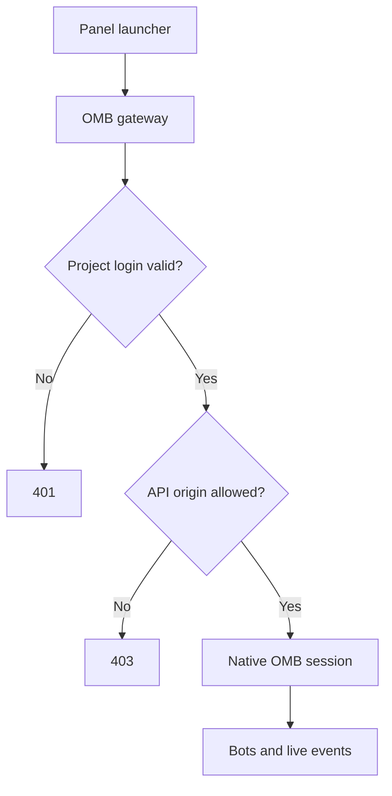
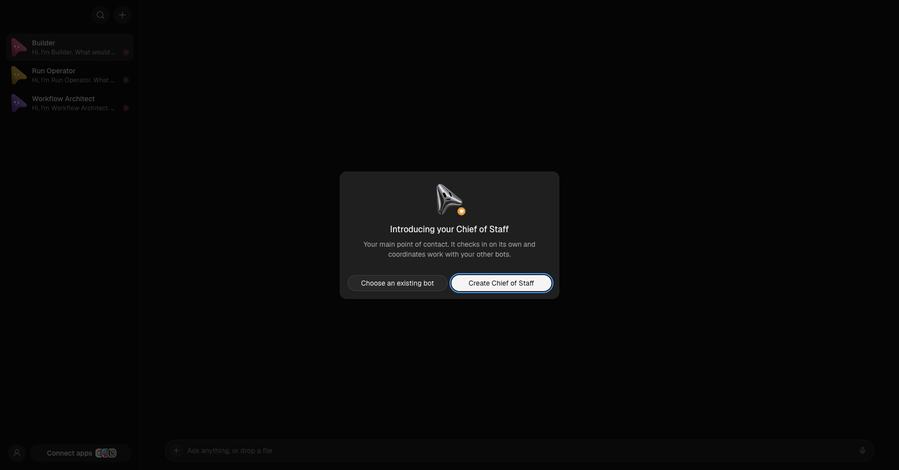

# Phase 5 delivery and OMB browser access

## Overview

The Builder workflow completes local coding-agent delivery. The panel now opens
OMB through the project gateway without asking for a pairing code. No remote was
configured, at the user's request; remote PR publication is deferred.

Contents: [User flow](#user-flow) · [Acceptance](#acceptance-matrix) ·
[Visual evidence](#visual-evidence) · [Validation](#automated-validation) ·
[Limits](#scope-and-limitations).

## User flow

The operator signs into the panel and clicks **Abrir OpenMausBot**. The launcher
opens the OMB gateway in another tab. That origin uses the same project credentials
(the browser may ask for them again). Caddy authenticates the operator, rejects
foreign-origin API requests, then adds its native OMB bearer session upstream.
The browser receives the native OMB UI, bots and event stream without seeing the
gateway token. The CLI still targets this project's own loopback port explicitly.



## Acceptance matrix

| Scenario | Expected result | Status | Evidence |
|---|---|---|---|
| Panel launcher | Opens OMB gateway | ✅ | [Manual Chrome](#visual-evidence) |
| Authenticated browser | Bots and events, no pairing code | ✅ | Chrome and HTTP checks |
| No project login | API returns 401 | ✅ | HTTP checks |
| Foreign origin / cross-site API | Returns 403 | ✅ | HTTP checks |
| Same-origin mutation | Native stream ticket succeeds | ✅ | HTTP checks |
| Token confidentiality | No gateway bearer in panel config or bot response | ✅ | HTTP checks |
| Builder with Codex | Local branch commit after checks | ✅ | [Run evidence](../../../docs/adr/phase-5-builder.md) |
| Builder with Claude | Successful subscription turn | ⚠️ | Subscription usage limit |
| Remote PR | Real template issue delivered through PR | ⚠️ | Deferred by user; no remote |

## Visual evidence

### OMB opens from the panel

Manual Chrome smoke, local isolated port block 19240–19249, 2026-11-06 UTC.
Clicked the panel's OMB link and loaded its native UI using project basic auth
(test header supplied by the browser tool on each origin). No OMB cookie or
pairing code was supplied. The first-use OMB tour is visible over the bot sidebar;
it is OMB onboarding, not the pairing screen reported by the user.

Observed network: `/api/auth/session`, `/api/bots?messages=200`, `/api/config`
and `/api/events?screens=off` returned **200**. No console warnings/errors observed.

<details>
<summary>Native OMB UI loaded without pairing</summary>
<p align="center">
  
</p>
</details>

## Automated validation

```sh
python3 -m unittest discover -s tests -p test_builder.py -v
FYSO_TEST_HTTP_PORT=19240 python3 -m unittest discover -s tests -p test_omb_gateway.py -v
```

Builder: **9 passed**, with pinned gitleaks on PATH. Gateway: **5 passed**, against
the real isolated stack. The gateway tests also pass on the user's running project
(port block 18400–18409). No mocked OMB responses. Shell syntax, Dagu validation,
path checks and `mise run doctor` passed. The user's immediate post-restart doctor
briefly raced Caddy startup; the later ready-state check passed.

## Scope and limitations

Gateway session credentials stay in ignored `.data/caddy/omb-session` (mode 600)
and the Caddy process environment. This is a shared operator session protected
by project login, not individual OMB device identity. Native session revocation or
logout can require restarting Caddy to mint a new session. CLI session creation
uses OMB's supported `connect` command; no OMB source code or auth bypass is used.
No bot message was sent during the browser access smoke. Only the user's Caddy
gateway was restarted when applying this fix; Dagu and OMB were left running.
