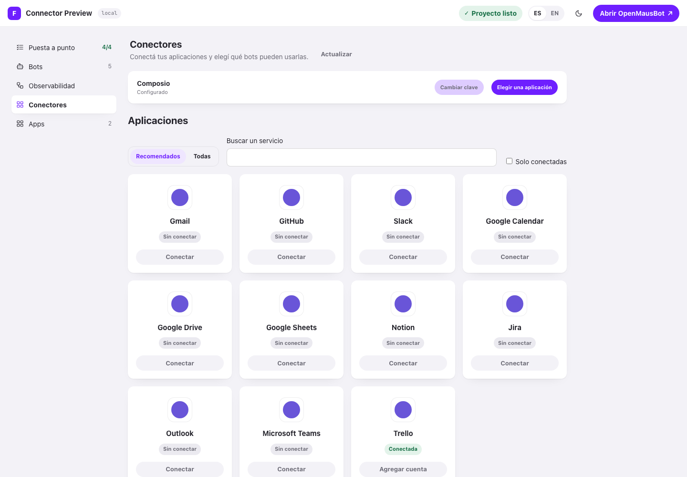
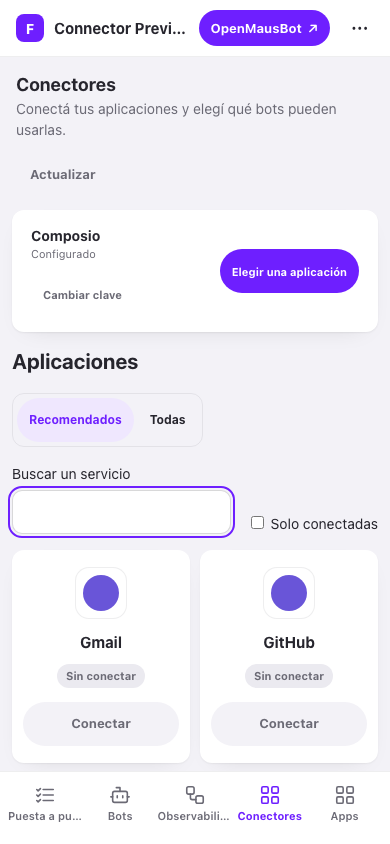
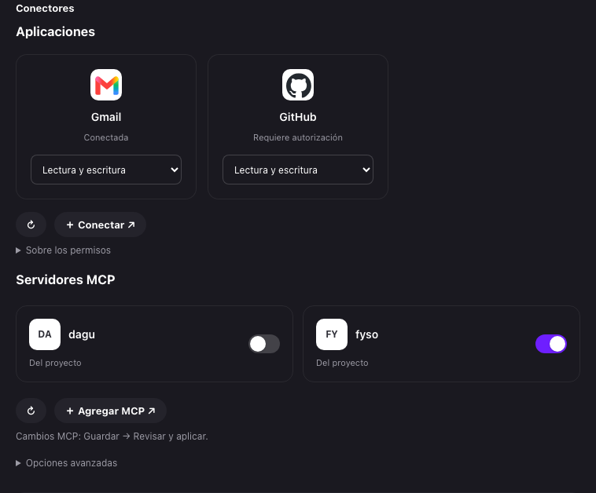
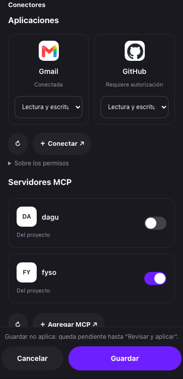

# Compact connectors and recommended applications

## Overview

The panel prioritizes provider artwork and concise actions. Bot app permissions use
small logo cards; the catalog opens on ten common work apps. Whop and Agentcard are
not recommendations and their native options remain under Advanced options.

## User flow

Open Connectors to browse Recommended. Choose All apps or search to find another
service. Previously saved connections remain visible even outside recommendations.
Connect starts the existing guided provider flow. Account details and removal are
available inside each card's account disclosure.

In a bot editor, choose app access on its logo card. Review and Apply retain their
native workflow. MCP cards retain their existing Save → Review and apply boundary.
Help and optional native source settings are collapsed, rather than removed.

## Acceptance matrix

| Behavior | Evidence | Result |
|---|---|---|
| Ten recommended services, no Whop/Agentcard | Executable catalog fixtures | Passed |
| Existing Trello remains visible outside recommendations | Executable catalog fixtures | Passed |
| Full catalog and search beyond recommendations | Executable catalog fixtures | Passed |
| Provider logos appear | Fixture image assertions and live Gmail logo load | Passed |
| No mobile overflow | 390px catalog and bot editor assertions | Passed |
| Native permissions still readable | Live isolated bot editor, read-only | Passed |
| Guided account consent preserved | Existing local consent-provider regression | Passed |
| Optional native sources preserved | Existing preference/hosted-flow test with simulated writes | Passed |

## Visual evidence

Local catalog presentation fixtures: ten curated services plus an existing Trello
connection. Test artwork is deliberately simulated; no popularity ranking is claimed.

Local catalog presentation fixtures at 390px: two compact columns and no horizontal overflow.

Real isolated preview, read-only: native Gmail/GitHub artwork, actual permission
selection and project MCP controls. Optional settings and explanations are collapsed.

Real isolated preview at 390px: logo cards and access selectors remain inside the form.

## Automated validation

Date: 2026-11-09. Isolated preview: `http://panel.localhost:19540`.

- `npm run build --prefix template/framework/panel`: passed.
- `mise run doctor` in the generated preview: all checks passed.
- `node tests/recommended-connectors-browser.cjs`: passed, zero page errors.
- `node tests/connected-apps-visibility-browser.cjs`: passed.
- `node tests/connector-guided-authorization-browser.cjs`: passed.
- `FYSO_TEST_PANEL=... FYSO_TEST_OMB_PORT=... node tests/native-connector-options-browser.cjs`: passed with simulated writes; real personal settings unchanged.
- Live dark/mobile bot-editor smoke: actual Gmail logo loaded; native permission read
  succeeded; no mutations and zero page errors.

## Scope and limitations

Recommendations are a curated product shortlist, not measured global usage.
Filtering and hiding advanced UI never delete credentials, accounts or permission
settings. Real external service execution was not invoked. The earlier native
permission mutation proof used only a disposable bot; see [app permission evidence](../app-permissions/README.md).
