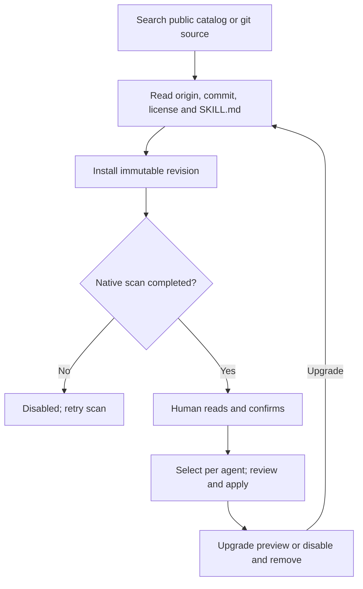
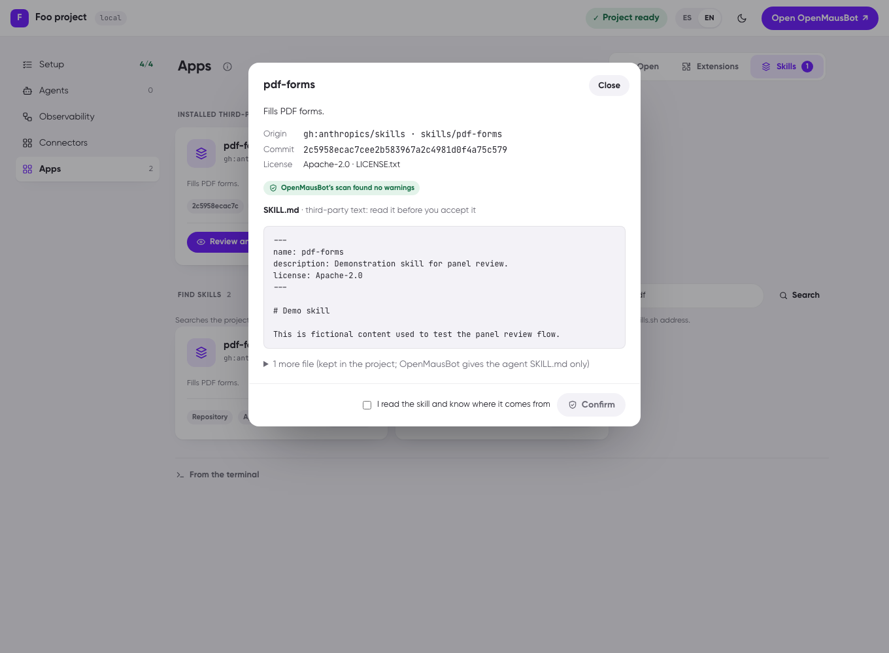
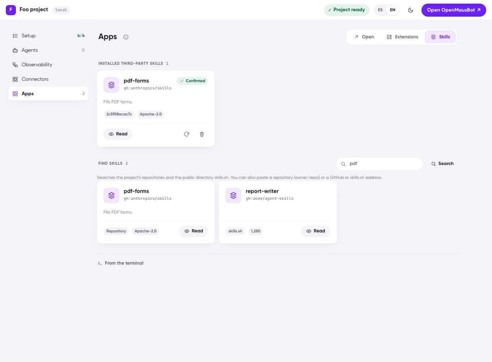

# Third-party skills — local delivery evidence

## Overview

The git-based lifecycle and pinned OpenMausBot scan were exercised on a disposable generated project. The panel flow was exercised separately with its mock backend. Full-stack doctor failed for fixture prerequisites; this is not a production or authenticated panel-to-Dagu acceptance claim.

## Contents

- [User flow](#user-flow)
- [Acceptance matrix](#acceptance-matrix)
- [Visual evidence](#visual-evidence)
- [Automated validation](#automated-validation)
- [Scope and limitations](#scope-and-limitations)
- [Handoff signals](#handoff-signals)

## User flow



## Acceptance matrix

| Scenario | Expected result | Status | Evidence |
|---|---|---|---|
| Anonymous public search | skills.sh returns public git source | ✅ | Real GET with generic `brand` query; spike |
| Real pinned install | Retained license/provenance; native scan; awaiting review | ✅ | Native lifecycle below |
| Before confirmation | Native team copy disabled | ✅ | Real OMB GET after rendered team apply |
| After confirmation | Native team copy enabled | ✅ | Real OMB GET after rendered team apply |
| Upgrade | New source revision invalidates review; native copy disabled on apply | ✅ | Native lifecycle below |
| Remove | Explicit disable first, then folder/provenance removed | ✅ | Native lifecycle and unit tests |
| Invalid scan attestation | No review allowed; probe cleaned up | ✅ | Focused unit test |
| Panel review flow | Confirmation disabled until acknowledgement | ✅ | Executable mocked browser and screenshots |
| Full authenticated panel/Dagu flow | Real workflow enqueue and gateway login | ⚠️ | Not exercised; browser uses mock backend |
| Full-stack doctor | All checks green | ⚠️ | Failed: incomplete fixture stack/no logged-in engine |
| Actual third-party skill execution | Bot can use its behavior and resources | ⚠️ | No bot turn; OMB imports SKILL.md only |

## Visual evidence

### Awaiting review

<details><summary>Mock panel: native-scan presentation and human acknowledgement</summary>

Executable Playwright against local built assets and the built-in mock backend. The owner sees origin, pinned commit, license, plain-text SKILL.md and the supporting-file limitation; Confirm is disabled before acknowledgement. This screenshot proves presentation, not a real scan.

<p align="center"></p>

</details>

### Confirmed

<details><summary>Mock panel: installed skill ready for per-agent selection</summary>

After checking the acknowledgement and confirming, the installed card shows Confirmed. This makes selection possible; installation and confirmation do not automatically assign an agent.

<p align="center"></p>

</details>

## Automated validation

Run from the framework checkout:

```sh
npm run typecheck --prefix template/framework/panel
npm run build --prefix template/framework/panel
PATH="$(mise where npm:yaml@2.8.1)/bin:$PATH" node --test \
  tests/skills.test.cjs tests/fyso-mcp.test.cjs tests/extensions.test.cjs \
  tests/marketplace.test.cjs tests/bot-form-connectors.test.cjs \
  tests/panel-bot-removal.test.cjs tests/bot-architect.test.cjs \
  tests/team-models.test.cjs tests/bot-roster.test.cjs
node tests/skills-browser.cjs
bash scripts/check-paths.sh
git diff --check
```

Build/typecheck: PASS. Browser smoke: PASS (search, read, install, acknowledgement gate, confirm, upgrade preview, remove and Spanish; no page errors). Chromium required execution outside the macOS sandbox because its Mach bootstrap is blocked there. Test server and browser close in `finally`.

Regression: **57 passed, 0 failed, 0 skipped** across the nine listed suites. A final targeted search/scan check after tightening catalog-response validation passed 2 tests. Path checking was also applied to untracked text because the repository's check-paths command scans the git index; no machine-specific paths were found.

### Real generated-project lifecycle

Copier 9.14.0 generated this worktree's template into a temporary project, using port block 31460–31469 and a separate temporary HOME. Pinned node 24.15.0, OMB 0.1.141, YAML 2.8.1 and real gitleaks 8.30.1 were used. Only OMB and its webhook listener were started, on 31464/31465, with this project's `.data/omb` and explicit ports. No other existing service was contacted.

The isolated Python command driver (`python3 "$EVIDENCE_DIR/runtime.py"`, retained with its log in the temporary evidence directory) ran the following script/CLI operations in the generated project:

1. `node framework/scripts/skills.cjs catalog`, `QUERY=brand`, sources `[skills.sh]`: found `brand-guidelines`.
2. `catalog`, `OP=add SRC=anthropics/skills SKILL=brand-guidelines COMMIT=ca45fc496a3436251f191354091d557da31c15b5`: obtained a plan.
3. `apply`, `OP=apply-plan PLAN_ID=<returned>`: installed that real revision, native scan passed, state `review`.
4. Team declared the skill; `render-team.cjs` rendered it; `openmausbot team apply <rendered-file> --port 31464 --json`; native GET showed `enabled:false`.
5. `apply`, `OP=confirm NAME=brand-guidelines SHA256=<reviewed-folder-digest>`; native team apply; GET showed `enabled:true`.
6. `catalog`, `OP=update NAME=brand-guidelines COMMIT=2c5958ecac7cee2b583967a2c4981d0f4a75c579`; apply-plan; state `review`; team apply; GET showed `enabled:false`.
7. Confirmed the new digest and applied; native copy enabled. Explicitly disabled the team entry and applied; `node framework/scripts/skills.cjs remove brand-guidelines`; folder/record absent; applying the remaining missing disabled entry succeeded.

All seven steps passed. This fixture had no git repository; selective lifecycle commits were verified separately by disposable-repository unit tests. No third-party instructions were followed or executed.

The spike also directly posted a clean fixture and a shell-pipe fixture to native `/skill-template`: both stayed disabled; only the latter returned the native shell-pipe warning; both probes were deleted.

### Doctor

`mise run doctor` in the same fixture: **FAIL, 4 checks**. The standalone OMB ports were busy, process-compose/full stack was not running, connector setup was unavailable, and no engine was logged in. A preliminary direct `setup.sh` invocation created fixture encryption and local-user data but exited on a missing environment path; it is not claimed as a successful setup run. No personal engine credentials were loaded to make doctor green. All checks for installed tools, decrypted fixture secrets, extension configuration and explicit OMB target passed.

## Scope and limitations

- Real scan/native team lifecycle and mock browser are separate evidence surfaces.
- No live gateway login, Dagu workflow execution, remote MCP client approval UI, Linux/Windows or third-party skill behavior was tested.
- OMB's native scan covers SKILL.md only; supporting-file functionality is not supplied by this feature.
- The unversioned anonymous directory endpoint can change; git discovery remains usable and errors are shown.
- Post-upgrade runtime synchronization requires explicit bot apply. Existing native copies persist until then.
- The initial Chromium sandbox launch failed; the outside-sandbox mock run passed. The initial focused test run skipped two tests without YAML on PATH; the regression run included YAML and had no skips.

## Handoff signals

D73 is provisional pending concurrent-branch decision numbering. No framework commits, pushes, PRs or branch switches were made. The OMB fixture was stopped and every port in 31460–31469 was verified bindable afterward. Test servers and browsers were closed. Temporary fixture/evidence files remain for review; no task-started service remains running.
