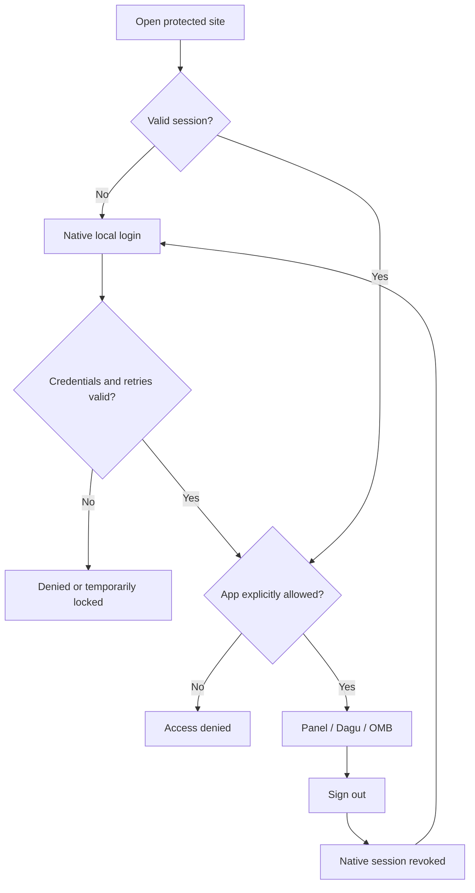
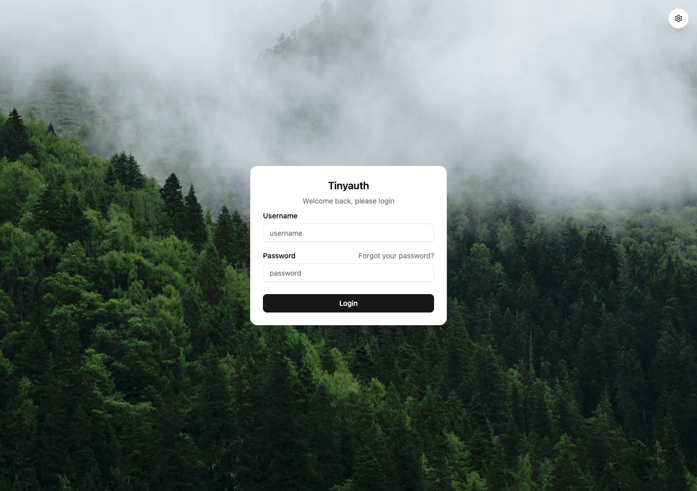
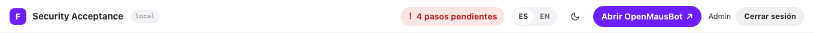
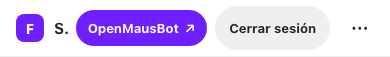
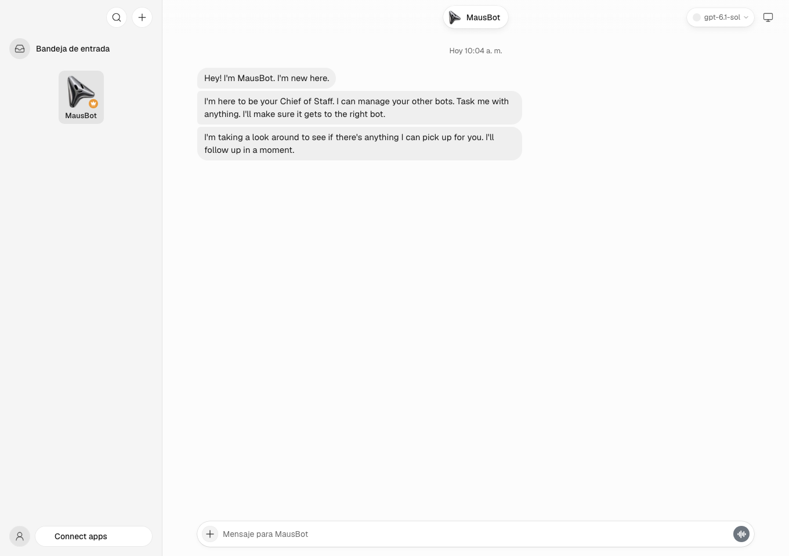

# Local users and shared web sessions — delivery evidence

## Overview

Verified on macOS arm64 on **2026-11-07, completed at 13:23 UTC**. The isolated
security branch replaces browser Basic challenges with unmodified Tinyauth local
users and a shared session across the panel, Dagu and OpenMausBot. Authenticated
browser navigation, cross-project cookie isolation, logout and rejected cookie
replay passed against real services. The generated project's doctor passed.
Existing user installations were not upgraded or restarted.

## Contents

- [User flow](#user-flow)
- [Acceptance matrix](#acceptance-matrix)
- [Visual evidence](#visual-evidence)
- [Automated validation](#automated-validation)
- [Scope and limitations](#scope-and-limitations)
- [Handoff signals](#handoff-signals)

## User flow

A local operator opens the panel and reaches the native login page. One successful
login authorizes all explicitly permitted applications. The panel displays the
current user and offers ES/EN sign-out. Signing out deletes the server-side session;
new requests to every protected application reject both the browser's old session
and explicit replay of the previous cookie. A second local account can be granted
OMB access while remaining denied at panel and Dagu.



## Acceptance matrix

| Scenario | Expected result | Status | Evidence |
|---|---|---|---|
| Browser entry | Native form, no HTTP Basic popup | ✅ | [Login](#native-login) |
| One session | Panel, real Dagu API and real OMB API accept the same browser session | ✅ | [Browser smoke](#browser-smoke) |
| Responsive session controls | Identity and sign-out on desktop; sign-out fits mobile | ✅ | [Session controls](#session-controls) |
| Cookie isolation | HttpOnly/Lax cookie is absent from another project domain and from document.cookie | ✅ | [Browser smoke](#browser-smoke) |
| Forged identity / technical Basic | Cannot bypass human authentication; verified identity replaces incoming headers | ✅ | [HTTP matrix](#native-http-matrix) |
| Upstream protection | Technical credentials stay server-side; the shared session cookie is stripped from upstream requests | ✅ | [HTTP matrix](#native-http-matrix) |
| Application ACLs | Second account denied at panel/Dagu; allowed at OMB; unknown app denied | ✅ | [HTTP matrix](#native-http-matrix) |
| Expiry / restart / retries | Sessions persist across restart, expire, and bad passwords trigger native lockout | ✅ | [HTTP matrix](#native-http-matrix) |
| Logout / replay | All subsequent API calls and explicit old-cookie replay return 401 | ✅ | [Sign out](#sign-out) |
| Native authority unavailable | Existing cookie does not open access; gateway fails closed | ✅ | [HTTP matrix](#native-http-matrix) |
| Encrypted account management | Preserves technical credentials/ACLs, prevents bootstrap deletion, invalidates sessions | ✅ | [User management](#encrypted-user-management) |
| Generated runtime | Pinned native build, isolated services, doctor green | ✅ | [Generated stack](#generated-stack) |
| Browser console | No JavaScript page errors; one console error entry observed | ⚠️ | [Limitations](#scope-and-limitations) |
| Public HTTPS / native per-user roles | Explicitly outside this local delivery | ⚠️ | [Contract](../../../docs/web-auth.md) |

## Visual evidence

### Native login

<details>
<summary>Native login form without a browser authentication popup</summary>

Automated Chromium capture before entering fixture credentials. The upstream
Tinyauth form owns authentication; no password or token is visible.

<p align="center"></p>

</details>

### Session controls

<details>
<summary>Verified identity and sign-out, desktop and mobile</summary>

The real panel displays the native authenticated identity and localized sign-out.
Captures focus on the changed controls. At 390 px the browser test also asserts
that the complete page has no horizontal overflow.

<p align="center"></p>
<p align="center"></p>

</details>

### Native OMB access

<details>
<summary>Native OMB reached through the existing shared web session</summary>

The same Chromium context reaches the real OMB onboarding screen without another
login or pairing code. Separately, its authenticated `/api/bots` response is 200
and contains the native chief. No conversation is sent and no AI turn is invoked.
This does not claim that OMB onboarding or bot provisioning was completed.

<p align="center"></p>

</details>

### Sign out

<details>
<summary>Native session revoked and browser returned to login</summary>

After the panel's sign-out request succeeds, Chromium returns to the native form.
The executable smoke then asserts 401 at panel, Dagu and OMB, including explicit
replay of the old cookie. Cookie values are never saved in artifacts.

<p align="center"></p>

</details>

## Automated validation

### Native HTTP matrix

```sh
FYSO_TEST_TINYAUTH="$FIXTURE/.data/web-auth/bin/tinyauth" \
FYSO_TEST_CADDY="$(mise -C "$FIXTURE" which caddy)" \
python3 -m unittest discover -s tests -p test_web_auth_http.py -v
```

**9 passed.** Actual Caddy 2.11.9 and Tinyauth 5.2.0 run on isolated port block
19800. Upstream echo fixtures test exact credential/header/cookie boundaries.
The suite stops its processes and removes its temporary data in cleanup.

### Browser smoke

```sh
FYSO_TEST_WEB_PANEL=http://panel.security-acceptance-19820.localhost:19820 \
FYSO_TEST_WEB_PASSWORD_FILE="$FIXTURE/.data/initial-password" \
node tests/web-auth-browser.cjs
```

**Passed**, headless Chromium, Spanish browser locale, desktop 1360×960 and mobile
390×844, one browser context, no retries. The existing Playwright installation was
made available through `NODE_PATH`; no browser dependency was added to the repo.
Login returned 200; native Dagu `/api/v1/dags` and OMB `/api/bots` returned 200;
a sibling-origin write was rejected with 403; subsequent calls after logout and
cookie replay returned 401. No JavaScript page errors were observed in panel/OMB.
One browser console error entry was observed; a clean console is not claimed.

### Encrypted user management

Run only against the **stopped**, generated `security-acceptance` fixture:

```sh
SOPS_AGE_KEY_FILE="$FIXTURE/.data/age.txt" \
MISE_SOPS_AGE_KEY_FILE="$FIXTURE/.data/age.txt" \
FYSO_TEST_WEB_PROJECT="$FIXTURE" \
FYSO_TEST_CADDY="$(mise -C "$FIXTURE" which caddy)" \
node tests/web-auth-users.cjs
```

**Passed.** Native SOPS encrypt/decrypt round trips verify password-hash encryption,
private file permissions, preservation of the Dagu technical credential, exact
username update/removal, refusal to remove the bootstrap account, unchanged app
permissions and session invalidation.

### Generated stack

A disposable project was rendered with Copier 9.19.1 (`security-acceptance`, block
19820), using its own age key and synthetic credentials. `mise install`, `setup`
and `web-auth:install` passed. The installer built the checksum-verified upstream
archive using pinned Go 1.26.8, pnpm 11.1.2 and the project's Node 24.15.0. It needed
explicit `mise which` tool resolution to avoid global shim/toolchain drift.

Real Dagu 2.24.0, OMB 0.1.141, Caddy and Tinyauth were started with this fixture's
process-compose socket and data directories. **`mise run doctor`: all checks
passed.** Its warning that declared bots differ is expected: this auth fixture
has only OMB's chief, and no bot apply/conversation was authorized by the smoke.
The stack was stopped after validation.

### Supporting regressions

```sh
node --test tests/extensions.test.cjs tests/fyso-mcp.test.cjs tests/agent-connect.test.cjs
python3 -m unittest discover -s tests -p test_installer_dag.py -v
python3 -m unittest discover -s tests -p test_tray.py -v
bash scripts/check-paths.sh
```

**17 Node checks, 3 installer checks and 10 tray checks passed.** Socket-based
checks required execution outside the filesystem sandbox. The initial sandbox
EPERM results were environment failures; their successful reruns are the reported
results. Panel TypeScript/build, modified shell syntax, Python AST syntax and
`git diff --check` passed. The extension lifecycle fixture was adapted for explicit
local login credentials, but its full Git-tag lifecycle was not rerun.

## Scope and limitations

- This is local, isolated acceptance. No release, remote CI, public deployment,
  existing-project migration or production-security certification is claimed.
- HTTP startup rejects non-loopback binding. Remote HTTPS/Secure-cookie deployment
  remains a Phase 6 gate.
- The native login screen keeps upstream presentation/languages. The panel's new
  controls are localized in ES/EN.
- Gateway identity and app-level access are unified; Dagu/OMB still use technical
  native credentials. Native per-person roles, history isolation and audit identity
  are not delivered by copying headers.
- Already open upstream streams are not forcibly terminated by a gateway logout;
  new requests/reconnects require authentication. Immediate stream revocation is
  not verified.
- The generated fixture was not initialized as a Git repository and its full setup
  checklist was not completed. It can show an unrelated snapshot/setup error.
  Captures of panel controls do not imply that checklist passed. One console error
  entry was recorded; it was not classified as a clean-console pass.
- OAuth/LDAP providers and TOTP are extension paths supported by the selected
  software, not live-tested integrations in this delivery.
- Native Linux execution and the packaged graphical installer were not rerun.

## Handoff signals

Implementation and evidence live on `feature/local-web-sso` in the dedicated
worktree requested by the user. The shared checkout's unrelated connector and
extension work was preserved. Publication and CI status are reported in the pull request; this evidence covers
local acceptance. No deployment was made. See the [web-auth contract](../../../docs/web-auth.md) for configuration,
account administration and existing-project migration requirements.
